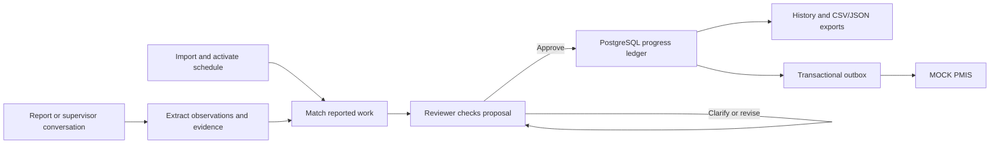
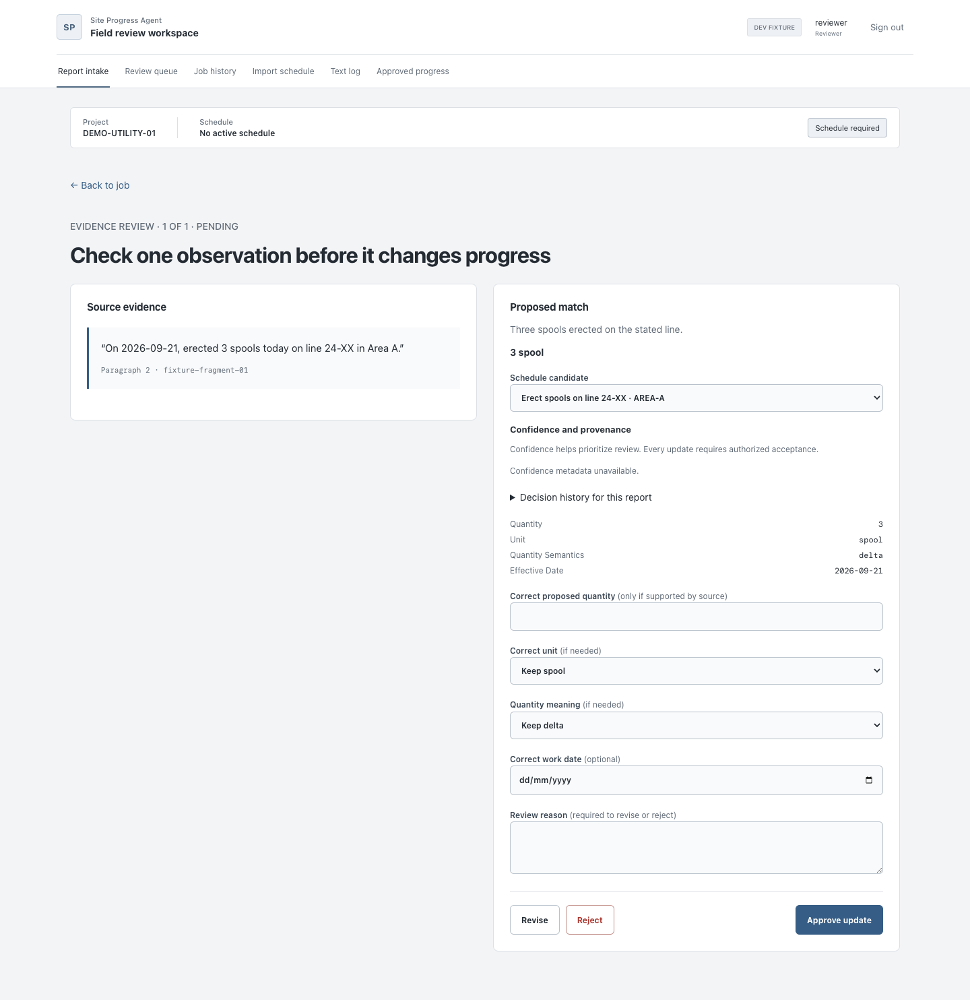

# Time Agent

**Construction progress reporting with source evidence and reviewer approval.**

[](https://github.com/sudo8phoenix/Time_Agent/actions/workflows/ci.yml)


[](LICENSE)

[User guide](docs/USER_GUIDE.md) · [Quick start](#quick-start) · [Documentation](docs/README.md) · [Model results](docs/MODEL_AND_PROMPT_COMPARISON_REPORT.md)

Time Agent helps construction supervisors and reviewers turn field reports and
conversations into progress updates tied to a versioned schedule. It extracts
reported work, proposes activity matches and shows the supporting source evidence.
An authorized reviewer approves each update before it changes the progress ledger.

> **Status: local prototype using public/synthetic data.** Production acceptance
> remains incomplete. External delivery targets **MOCK PMIS — prototype**.
> Software test passes do not establish model accuracy or sustained capacity.
> See [verified results and limitations](docs/TESTING_AND_QUALITY.md).

## How it works



Schedule import, model analysis, reviewer approval and external delivery are
separate stages. Ambiguous or unsupported observations can abstain or require
clarification. Corrections retain an audited history.

## Capabilities

| Area | Available behavior |
|---|---|
| Schedule intake | Canonical CSV, Primavera XER/P6 XML, Microsoft Project MPP/MSPDI XML, GT10 XLSX and derived Cambridge JSON |
| Report intake | Pasted text, TXT, DOCX, text PDF and supported/mapped XLSX, with source locators |
| Agent workflow | Versioned LangGraph analysis, bounded repairs, optional hierarchical orchestration and durable conversations |
| Review | Evidence inspection, activity resolution, authorized approval, rejection, corrections and retractions |
| Progress | Activity-level quantities, percentages, lifecycle history and approved CSV/JSON exports |
| Delivery | Transactional snapshots, retries and receipts through the mock PMIS adapter |

Scanned PDFs require reviewed transcription; standalone image reports and automatic
OCR are unsupported. Native schedule support is file import, without live vendor
synchronization. See [document limits](docs/document-input-capabilities.md) and
[integration boundaries](docs/INTEGRATIONS.md).

## Workspace preview



*Captured from synthetic frontend fixture mode. This illustrates the interface;
fixtures do not demonstrate live model quality or external delivery. More screens
and instructions are in the [user guide](docs/USER_GUIDE.md).*

## Quick start

### Docker on Linux, macOS or Windows

Use Docker Engine with Compose, or Docker Desktop in Linux-container mode. The
image includes the frontend, Python and Java; parsing runs in a separate
credential-free container with networking disabled.

```sh
cp .env.example .env
# Configure a random SECRET_KEY and your model endpoint/credentials in .env.
docker compose build parser
docker compose up -d --wait db parser
docker compose run --rm --no-deps api alembic upgrade head
docker compose up -d api worker
```

Open `http://localhost:8000`. For host Ollama, use a host-reachable endpoint such
as `http://host.docker.internal:11434` in `.env`. Production registration is
disabled by default. See [deployment](docs/DEPLOYMENT.md) and
[security controls](docs/SECURITY.md) before shared deployment.

### Host development requirements

- Python **3.12** and Node.js/npm; CI uses **Node 20**.
- Docker for PostgreSQL **16** and the isolated parser service.
- Java for native schedule parsing.
- A configured Ollama endpoint or supported hosted provider credentials.

### Install and configure

```sh
git clone https://github.com/sudo8phoenix/Time_Agent.git
cd Time_Agent
cp .env.example .env
make bootstrap
cd frontend
npm ci
cd ..
```

Edit `.env` before starting services. Replace `SECRET_KEY` with a random private
value and select your provider/model settings. The template defaults to Ollama;
its model name must match the endpoint's installed model. Keep credentials out of Git.

```sh
make db-up
make migrate
make build-web
make seed-demo
```

`make seed-demo` prompts for a password for `demo-reviewer`.

### Start the application

Document parsing requires the shared parser socket. Run API and worker through
Docker Compose for portable access, especially on Docker Desktop where named
volume sockets are inside the Linux VM. Host-only API development supports routes
that do not parse documents unless `PARSER_SOCKET_PATH` reaches the isolated service.

For host-only development, run the API and worker in separate terminals:

```sh
make serve PORT=8001
```

```sh
make worker
```

Open **<http://127.0.0.1:8001/>** and sign in. Import and explicitly activate a
schedule, submit a report, review the evidence, then inspect approved progress.
Use the [local runbook](docs/local-run.md) for development servers, mock delivery,
backup and recovery, or [troubleshooting](docs/TROUBLESHOOTING.md) for blocked steps.

### Optional hierarchical profile

Checked-in defaults disable hierarchical and model-assisted routing. The documented
selected local profile, checked on 26 October 2026, enables V2 with Groq Qwen
3.8 27B for orchestration, GPT-OSS 120B for extraction and GPT-OSS 20B for selection. It requires explicit configuration and private
provider keys; it is not automatically enabled by installation.

Follow the [profile configuration](docs/local-run.md#setup),
[settings reference](docs/CONFIGURATION.md) and
[provider capacity rules](docs/provider-capacity.md). Existing runs retain pinned
versions and budgets; configuration changes require deliberate process restarts.
The [four-model role comparison](docs/FOUR_MODEL_ROLE_COMPARISON.md) records
16 worker pairs and 64 composed assignments; these are single-report trials, not
64 database-backed graph runs.

## Documentation

The [documentation hub](docs/README.md) groups all maintained guides by audience.

| Purpose | Guides |
|---|---|
| Use the workspace | [User guide](docs/USER_GUIDE.md), [document support](docs/document-input-capabilities.md), [schedule matching](docs/SCHEDULE_MATCHING.md) |
| Understand the design | [System overview](docs/SYSTEM.md), [agent architecture](docs/AGENT_ARCHITECTURE.md), [data flow](docs/DATA_FLOW.md), [data model](docs/DATA_MODEL.md) |
| Build integrations | [API reference](docs/API_REFERENCE.md), [OpenAPI snapshot](docs/api-contract.json), [integrations](docs/INTEGRATIONS.md) |
| Operate the service | [Local runbook](docs/local-run.md), [configuration](docs/CONFIGURATION.md), [deployment](docs/DEPLOYMENT.md), [observability](docs/OBSERVABILITY.md) |
| Review safety and recovery | [Security](docs/SECURITY.md), [durable configuration](docs/durable-model-configuration.md), [provider capacity](docs/provider-capacity.md), [troubleshooting](docs/TROUBLESHOOTING.md) |
| Assess model behavior | [Testing and quality](docs/TESTING_AND_QUALITY.md), [model comparisons](docs/MODEL_AND_PROMPT_COMPARISON_REPORT.md), [research report](docs/EVALUATION_RESEARCH_REPORT.md), [evaluation tools](evaluation/README.md) |
| Inspect exact prompts | [Prompt catalog](docs/MODEL_PROMPT_CATALOG.md), [generation settings](docs/model-generation-settings.md), [authority inventory](docs/model-call-authority-inventory.md) |
| Contribute and track changes | [Contributing](docs/CONTRIBUTING.md), [changelog](CHANGELOG.md) |

The running API exposes Swagger UI at `/docs` and its schema at `/openapi.json`.
API authentication uses a session cookie and CSRF protection for protected writes.

## Development and verification

```sh
make test-unit
make test-integration
cd frontend
npm run typecheck
npm run build
npm run test:e2e
```

Integration tests require an isolated local test database and block uninjected
hosted-provider HTTP. Live model studies are separate operations that consume
provider quota. Current CI runs unit tests, frontend typecheck and build;
integration and browser checks require separate execution.

Recorded software checks, model measurements, reproduction commands and open
acceptance gates live in [testing and quality](docs/TESTING_AND_QUALITY.md).
Small public/synthetic regression fixtures and curated screenshots are versioned.
Raw evaluation captures, historical handoffs, private uploads, credentials and
operator archives remain local and ignored.

## Repository structure

```text
Time_Agent/
├── backend/app/          # API, agents, ingestion, ledger and integrations
├── backend/migrations/   # Alembic database migrations
├── backend/tests/        # Unit, integration and native import checks
├── frontend/             # React/Vite workspace and browser tests
├── data/                 # Versioned datasets, manifests and review fixtures
├── docs/                 # User, engineering, operations and research guides
├── evaluation/           # Study runners, scorers, contracts and fixtures
├── ops/                  # Workers, diagnostics, mock receiver and backup tools
├── .env.example          # Publishable configuration template
└── Makefile              # Setup, run and verification commands
```

The stack is **FastAPI, SQLAlchemy/Alembic, PostgreSQL, LangGraph, React,
TypeScript and Vite**. See the [system source map](docs/SYSTEM.md#source-map)
for component responsibilities.

## Contributing and reporting issues

Read [CONTRIBUTING](docs/CONTRIBUTING.md) before proposing changes. Report bugs
through GitHub Issues with a minimal reproduction and sanitized diagnostics.
Follow [security reporting](docs/SECURITY.md#reporting-vulnerabilities) for
vulnerabilities; keep keys, cookies and private reports out of public issues.

## License

**Proprietary — all rights reserved.** Public repository access does not grant
permission to reuse or redistribute the code. See [LICENSE](LICENSE).
Third-party dependencies and identified datasets retain their respective licenses.
