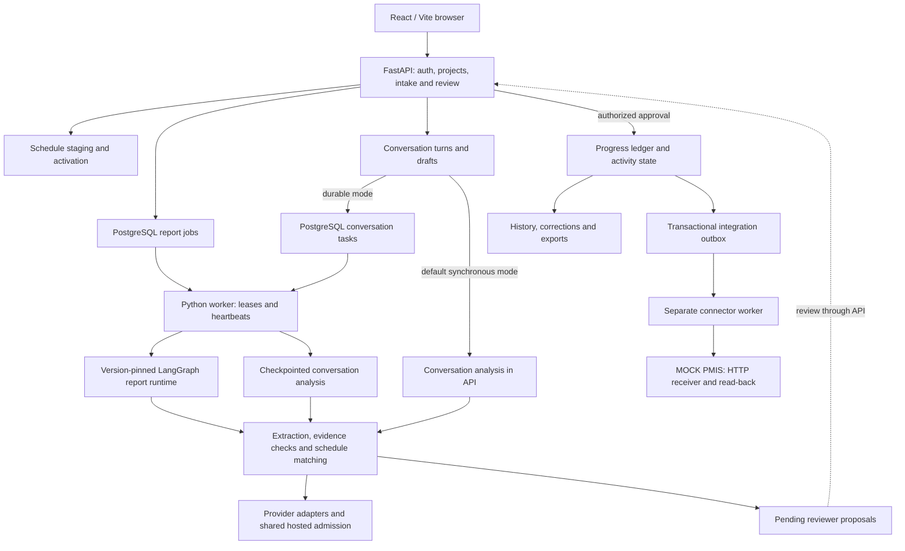

# Time Agent

[](https://www.python.org/)
[](https://fastapi.tiangolo.com/)
[](https://react.dev/)
[](https://www.postgresql.org/)
[](https://langchain-ai.github.io/langgraph/)

Time Agent turns construction reports and supervisor conversations into evidence-backed progress proposals. It imports project schedules, extracts reported work, matches observations to the pinned schedule, and sends proposals to an authorized reviewer. Approval updates the progress ledger, history and exports; an outbox can deliver committed snapshots to **MOCK PMIS — prototype**.

The backend uses FastAPI, PostgreSQL and versioned LangGraph workflows; the frontend uses React and Vite. A hierarchical agent runtime, scoped specialists and durable conversation tasks are implemented. The hierarchy is available behind a rollout flag and runs sequentially inside the worker.

**Status:** the public/synthetic prototype is implemented, but release acceptance is incomplete. Both rollout flags remain off. The local extraction profile uses Groq `openai/gpt-oss-20b`; the checked-in `.env.example` starts with Ollama. See [current status](docs/current-status.md) for the six remaining acceptance workstreams and measured limitations.

## What it supports

- CSV and native schedule import, including XER, P6 XML, MSPDI and MPP, with reviewed staging and activation.
- Text and mapped spreadsheet reports, plus immutable PDF-page transcription with source locators.
- Evidence-backed observations for actual starts/finishes, quantities, blockers, deliveries, planned work and no work.
- Lifecycle conversations with date/location/scope clarification and explicit confirmation into the review queue.
- Model-led candidate discovery over a pinned schedule, followed by selection or abstention.
- Authorized approval, corrections/retractions, progress history, precision-aware duration queries and CSV/JSON export.
- Durable report checkpoints, leased tasks, bounded recovery, private provenance and sanitized public run status.
- Automatic outbox delivery and verified read-back through the mock connector.

## Architecture



PostgreSQL stores application state, report checkpoints, task/call journals, audit traces and hosted admission state. Uploaded source files are stored separately. The mock receiver maintains its own SQLite store. Database transactions do not span hosted admission waits or durable worker inference.

### Versioned report hierarchy

| Area | Default behavior | Optional hierarchical behavior |
|---|---|---|
| Reports | `report-analysis-v1`: bounded extraction → matching → review persistence graph | `report-analysis-v2`: root orchestrator with nested supervisor graphs |
| New conversations | Synchronous analysis through the API | `conversation-analysis-v1`: leased worker tasks and model-call journals |
| Supervisor routing | Deterministic | Optional model-assisted confirmation of the next legal supervisor action |
| Model assignments | Baseline provider/model for v1 reports | Pinned extraction, selection and optional orchestrator assignments |

The v2 report hierarchy is defined in [hierarchy.py](backend/app/agent/hierarchy.py), with delegation rules in [registry.py](backend/app/agent/registry.py):

```text
Root orchestrator
├── Intake supervisor
│   └── Clarification role registered for intake delegation
├── Analysis supervisor
│   ├── Extraction specialist
│   ├── Matching supervisor
│   │   └── Selection specialist
│   └── Evidence validation specialist
└── Review preparation supervisor → pending proposals
```

The current report intake graph loads context; conversation analysis provides user-facing clarification. These roles are scoped components inside the Python runtime, each with explicit contracts, budgets and permitted capabilities. Specialist execution is sequential; it does not require a separate server or model for each role. Multiple worker processes can claim independent jobs, but sustained capacity remains unproven.

`AGENT_HIERARCHY_ENABLED=true` selects v2 for new report runs and durable analysis for new conversations. Existing reports dispatch from their stored graph/state versions; existing durable conversations keep their journals. Disabling the flag changes subsequent work without rewriting in-flight records. There is one supported report execution engine: LangGraph.

`ORCHESTRATOR_MODEL_ASSISTED=false` keeps supervisor routing deterministic. The optional planner validates a supplied legal action; it does not freely invent workflows or approve progress. Supported planner assignments include Groq `openai/gpt-oss-120b` and the explicitly allowlisted OpenRouter free models in [planner.py](backend/app/agent/planner.py). This planner configuration is separate from the local GPT-OSS 20B extraction profile.

### Extraction, matching and recovery

Extraction validates observations against the schema and exact source evidence. Matching traverses pinned leaf schedule rows in bounded model requests, retains at most eight candidates, then selects a supplied candidate or abstains. This is model-led discovery, rather than the older embedding/hybrid retrieval architecture.

The default extraction prompt is V12 (`extraction-v12-source-clause-check`). V20 (`extraction-v20-short-schedule-ids`) is an explicit candidate with request-local schedule aliases and conservative repeated-heading evidence repair. Starting the app or enabling the hierarchy does not automatically select V20. Saved prompts, role assignments and configuration preserve each run's provenance.

Report jobs use PostgreSQL checkpoints, ownership leases and independent heartbeats. Durable conversations reserve model-call budgets before inference and journal completed responses for validated replay. Both paths preserve pinned schedule scope. The model can prepare review proposals; authorized API approval controls ledger changes.

### Hosted provider capacity

Groq and OpenRouter adapters use PostgreSQL admission shared across roles, models, key slots and processes using the same database. All three configured Groq keys share one organization quota. Separate databases and external clients are outside that coordinator. Requests have finite budgets, zero transport retries and no automatic cross-provider/model fallback.

The latest measured extraction took 47.134 seconds: 46.312 seconds waiting for admission and 0.806 seconds in remote request/response transport. This single sample identifies quota pacing as its dominant delay; it is not a sustained p95 or a standalone model-generation benchmark. See [provider capacity](docs/provider-capacity.md).

## Quick start

Requirements: Python 3.12, Node.js/npm (CI uses Node 20), Docker with PostgreSQL, Java for native schedule parsing, and credentials or an endpoint for the selected model provider.

For a fresh checkout:

```sh
git clone https://github.com/sudo8phoenix/Time_Agent.git
cd Time_Agent
cp .env.example .env
make bootstrap
cd frontend && npm ci && cd ..
make db-up
make migrate
make build-web
```

Edit `.env` with a random `SECRET_KEY` and the provider you intend to use. For Groq:

```dotenv
LLM_PROVIDER=groq
GROQ_MODEL=openai/gpt-oss-20b
GROQ_API_KEY=your-server-side-key
AGENT_HIERARCHY_ENABLED=false
ORCHESTRATOR_MODEL_ASSISTED=false
```

Check role-specific overrides if already configured. The example file otherwise selects Ollama at `http://127.0.0.1:11434` with `qwen3.5:4b`. OpenRouter requires an explicitly selected model ID. Provider requests send report/model context to the chosen service; credentials remain server-side.

Create a demo reviewer and synthetic schedule without resetting existing data:

```sh
make seed-demo
```

The command prompts for a new password when needed; the username is `demo-reviewer`. In separate terminals, start:

```sh
make serve PORT=8001
```

```sh
make worker
```

Open **http://127.0.0.1:8001/**. Check API liveness with:

```sh
curl --fail http://127.0.0.1:8001/api/v1/health/live
```

`make serve` without a port uses 8000. The API serves the built frontend from `frontend/dist`; rebuild after frontend changes. Apply migrations through `0018_hosted_admission` before using the current hosted transports. The connector and mock receiver are separate optional processes; see [the local runbook](docs/local-run.md) for their commands and recovery procedures.

## Configuration

| Setting | Purpose |
|---|---|
| `DATABASE_URL` | PostgreSQL application, checkpoint, task and admission storage |
| `SECRET_KEY` | Server signing key; keep it private |
| `LLM_PROVIDER` | Base provider: `ollama`, `groq` or `openrouter` |
| `GROQ_MODEL`, `GROQ_API_KEY` | Groq model and original credential slot |
| `GROQ_API_KEY_1`, `GROQ_API_KEY_2` | Additional explicit slots; they do not add independent organization quota |
| `OLLAMA_BASE_URL`, `OLLAMA_MODEL`, `OLLAMA_API_KEY` | Private/local Ollama configuration and optional authentication |
| `OPENROUTER_MODEL`, `OPENROUTER_API_KEY` | Explicit OpenRouter model and credentials |
| `EXTRACTION_*`, `SELECTION_*`, `ORCHESTRATOR_*` | Role-specific `PROVIDER`, `MODEL` and `KEY_SLOT` assignments where supported by the runtime |
| `AGENT_HIERARCHY_ENABLED` | New v2 reports and durable conversations; default `false` |
| `ORCHESTRATOR_MODEL_ASSISTED` | Model-assisted v2 supervisor routing; default `false` |
| `REPORT_MODEL_TIMEOUT_SECONDS` | Report request budget, including admission; default 360 s |
| `CONVERSATION_MODEL_TIMEOUT_SECONDS` | Conversation request budget; default 300 s |
| `UPLOAD_DIR`, `FRONTEND_DIST` | Source-file storage and built frontend location |

Role assignments are pinned by hierarchical reports and durable conversation tasks. Baseline reports use their saved provider/model. Restart the API and worker after configuration changes; old work retains its own saved configuration. The browser cannot select model endpoints, prompts or internal checkpoints. See [runtime configuration](docs/multi-agent-runtime.md) and [durable conversations](docs/durable-conversations.md).

## Verification and acceptance

```sh
make test-unit
make test-integration
make native-smoke
cd frontend && npm run typecheck && npm run build && node tests/frontend-contracts.test.mjs
```

The integration suite uses the isolated `progress_test` database. Unit schedule tests generate synthetic inputs and do not require external Cambridge/GT10 downloads. Clean-checkout verification after the CI portability fix passed **454 unit tests with one skipped test**; the latest full local integration run passed **201 tests**. Frontend typecheck/build/contracts also passed. These are dated regression results, not live quality or capacity acceptance.

For read-only database, queue and cooldown status:

```sh
PYTHONPATH=backend .venv/bin/python ops/runtime_status.py
```

`make doctor` checks database/native prerequisites and the configured **Ollama** endpoint; it does not certify Groq/OpenRouter health. Use saved request provenance and the [evaluation tools](evaluation/README.md) for provider-specific evidence.

Release work remains in six areas: sustained provider capacity, broader quality, fresh V20 validation and a newly frozen holdout, supported/runtime confidence, concurrent browser/update/mock-delivery latency, and accepted-source release steps. V19 holdout results are consumed. Runtime confidence remains unavailable, and isolated successful timings do not clear sustained operation. Publishing candidate code to Git is separate from accepted-release freeze or deployment. See [current status](docs/current-status.md) and [approved targets](docs/evaluation-targets-approved-2026-10-16.json).

## Repository layout

```text
Time_Agent/
├── backend/app/agent/          # Versioned graphs, supervisors, specialists and task contracts
├── backend/app/conversation/   # Lifecycle drafts and durable analysis journals
├── backend/app/llm/            # Provider adapters, shared admission and numeric metrics
├── backend/app/ingest/         # Reports, schedules and native/public-source adapters
├── backend/app/progress/       # Deterministic approved effects and activity projections
├── backend/app/integrations/   # Outbox, mock connector and delivery/read-back handling
├── backend/migrations/         # Application, checkpoint and operational schemas
├── backend/tests/              # Unit and isolated PostgreSQL integration tests
├── frontend/                   # React/Vite UI, contracts and Playwright scenarios
├── data/                       # Synthetic fixtures, split labels and source/review records
├── evaluation/                 # Capture/scoring tools and retained candidate evidence
├── ops/                        # Workers, mock receiver, status, backup/restore and diagnostics
├── docs/                       # Runtime guides, release gates and historical handoffs
├── .github/workflows/          # CI unit tests, frontend typecheck and build
└── Makefile                    # Setup, migration, build, checks and worker commands
```

## Security, data and recovery

Authentication, project membership, CSRF protection, pinned schedules, revision checks and idempotent approval guard mutations. Source text is untrusted. Agents have bounded application capabilities; they do not receive browser credentials or approve ledger effects. Public traces expose sanitized stages, counts, timings and stable errors rather than private checkpoints or raw model bodies.

Keep `.env`, credentials, uploaded reports, local imported schedule copies, databases, logs, model weights and generated builds out of Git. Only identified synthetic/public-source fixtures and reviewed publication artifacts belong in the repository. No owner sample is expected for this prototype; AI-assisted labels are not independent human review or proof of owner-project accuracy.

Backup/restore includes original source files, approved state, job/task lineage, conversations, graph checkpoints, outbox and admission state. The mock receiver's separate store needs its own backup. Restore verification refuses to replace an existing database:

```sh
make backup ARGS="--output /absolute/new-backup-directory --quiesced"
make restore-verify ARGS="/absolute/new-backup-directory --database progress_restore_example --uploads /absolute/new-restore-uploads"
```

## Documentation

- [Current status](docs/current-status.md) — latest evidence, model/latency breakdown and remaining gates.
- [Hierarchical runtime](docs/multi-agent-runtime.md) — versions, roles, planner configuration and rollout controls.
- [Durable conversations](docs/durable-conversations.md) — worker dispatch, journals, budgets and retry behavior.
- [Local runbook](docs/local-run.md) — startup, provider setup, mock delivery and recovery.
- [Provider capacity](docs/provider-capacity.md) — shared admission, quota observations and failure policy.
- [Evaluation guide](evaluation/README.md) and [results](evaluation/RESULTS.md) — reproducible studies and their limits.
- [Release evidence](docs/release.md), [split status](docs/data-splits.md) and [confidence contract](docs/confidence-calibration.md).
- [Documentation index](docs/README.md) — remaining guides and dated implementation records.

## Contributing and issues

Use a focused branch, preserve existing evidence and run checks appropriate to the change. Include reproducible inputs, expected behavior, actual behavior and environment details in [GitHub issues](https://github.com/sudo8phoenix/Time_Agent/issues). Keep private reports and secrets out of issues and test artifacts.

## License

No project-wide license has been declared. Source datasets and third-party components retain their own terms; see [the source registry](data/references/schedule-sources.json) and retained notices.

## Acknowledgements

Built with FastAPI, Pydantic, SQLAlchemy, Alembic, PostgreSQL, React, Vite, LangGraph, MPXJ and the configured model-provider adapters.
