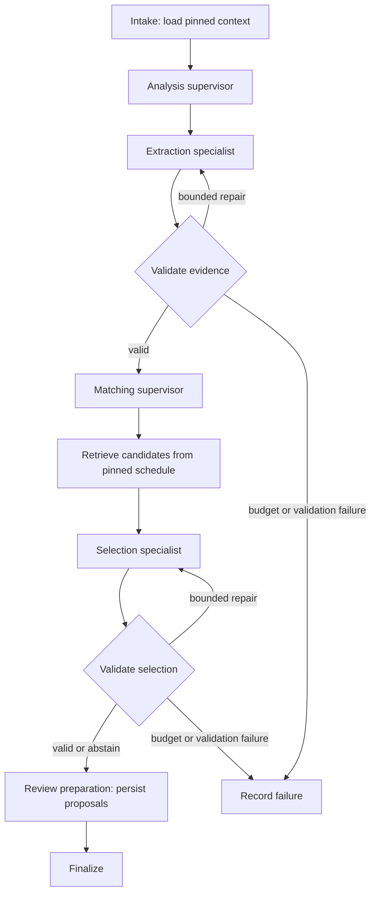

# Agent architecture

The Python application runs bounded LangGraph workflows. Agent roles are scoped
components inside a process; each role is not a separate service. Supervisor
execution is sequential. Workers can claim independent jobs.

## Report engines

| Version | Selection | Behavior |
|---|---|---|
| V1 | Checked-in default | Fixed extraction, matching, validation and persistence graph |
| V2 | `AGENT_HIERARCHY_ENABLED=true` for new work | Root supervisor and nested specialist graphs |
| Model-assisted V2 | Also enable `ORCHESTRATOR_MODEL_ASSISTED` | Planner confirms supplied legal supervisor actions |

This diagram summarizes shared behavior. Exact V1 transitions live in
[graph.py](../backend/app/agent/graph.py); nested V2 graphs live in
[hierarchy.py](../backend/app/agent/hierarchy.py).

## Responsibilities and tools

| Component | Responsibility | Authority |
|---|---|---|
| Intake supervisor | Load report fragments, project and schedule context | Read pinned context |
| Extraction specialist | Propose structured observations and source evidence | Produce validated drafts |
| Matching supervisor | Discover in-scope leaf activities | Candidate retrieval |
| Selection specialist | Select a supplied activity or abstain | No arbitrary activity IDs |
| Evidence validation | Check schema, evidence and scope | Reject/repair invalid drafts |
| Review preparation | Persist pending proposals | Cannot approve ledger changes |
| API reviewer controls | Approve, revise, reject, correct or retract | Authenticated, revision-checked writes |

The traced application tool surface contains `load_job_context`,
`extract_observations`, `retrieve_candidates`, `select_candidate`,
`validate_proposal_drafts` and `persist_review_proposals`. The Python control plane
calls these functions; they are not general filesystem, shell or network tools
available to the model. Clarification roles are registered, while conversation
analysis provides the user-facing clarification flow.

## Checkpoints and recovery

PostgreSQL stores LangGraph checkpoints and application jobs, runs, tasks, steps
and tool-call records. Job leases and heartbeats fence ownership. Durable
conversation tasks reserve budgets and journal completed calls for validated replay.
Checkpoint storage is distinct from sanitized telemetry: a trace record alone does
not prove a node was checkpointed. Telemetry reconciliation handles interrupted
trace commits around durable nodes.

Source, dependencies, state/schema versions, prompts and model assignments are
pinned. Changed or unpinned legacy work stops before new inference. Switching a
flag changes new work; it does not rewrite an existing run. Cancellation fences
late publication. Repairs, retries and admission waits remain subject to retained
budgets. Never reset counters or checkpoints to force resumption.

See [durable configuration](durable-model-configuration.md),
[authority inventory](model-call-authority-inventory.md),
[observability](OBSERVABILITY.md) and [matching](SCHEDULE_MATCHING.md).

---

[Documentation index](README.md) · [Project overview](../README.md)
