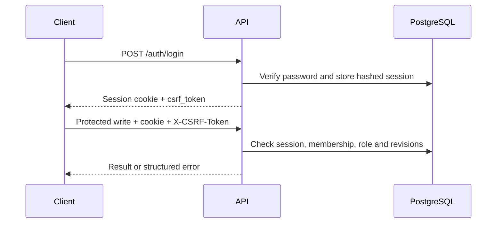

# API reference

> Contract: application version 0.1.0. Base path: `/api/v1`.

Use `/docs` for interactive Swagger UI and `/openapi.json` for the running schema.
The checked-in [OpenAPI snapshot](api-contract.json) supports offline inspection.
Neither the UI nor schema is a substitute for endpoint authorization.

## Authentication and authorization

Sign in with `POST /auth/login` using JSON `username` and `password`. The response
contains `csrf_token` and `user`; the `progress_session` cookie is HttpOnly,
SameSite=Lax, lasts up to 12 hours and is Secure when `ENVIRONMENT=production`.
Send the cookie on authenticated requests and `X-CSRF-Token` on protected writes.
`GET /auth/me` returns the current user, project memberships and refreshed CSRF token.
Logout revokes the session. There is no bearer-token API authentication.

Project membership limits access. Review writes require the reviewer role.
Registration currently creates a reviewer and a project; deployment must account
for this public registration behavior. See [security](SECURITY.md).



## Request and response conventions

Identifiers are UUIDs unless specified; schedule activation uses an integer version.
Dates use ISO `YYYY-MM-DD`. Preserve returned revisions when editing or approving.
An asynchronous `202` means accepted for processing, not approved progress.
Read list responses individually: pagination and response envelopes vary by endpoint.
Some handlers return dictionaries without declared response models; the generated
schema does not fully describe those response bodies.

## Examples

Use local synthetic data. Keep cookie files private and remove them after use.
Set `CSRF_TOKEN` from the login response and `PROJECT_ID` from `/auth/me`.

```sh
curl -c /tmp/time-agent.cookies -H 'Content-Type: application/json' \
  -d '{"username":"demo-reviewer","password":"YOUR_LOCAL_PASSWORD"}' \
  http://127.0.0.1:8001/api/v1/auth/login

curl -b /tmp/time-agent.cookies http://127.0.0.1:8001/api/v1/auth/me

curl -b /tmp/time-agent.cookies -H "X-CSRF-Token: $CSRF_TOKEN" \
  -H 'Content-Type: application/json' \
  -d '{"text":"Area A: erected three spools on line 24-XX.","report_date":"2026-10-23"}' \
  "http://127.0.0.1:8001/api/v1/projects/$PROJECT_ID/reports"
```

A report submission returns `report_id`, `job_id`, `project_id`,
`schedule_version_id`, `existing`, `state`, `stage`, `attempts`, counts and
`proposal_ids`. Poll `/jobs/{job_id}`; fetch report details using the project-scoped
report route in the inventory below.

Approval body (replace revisions and the key with current values):

```json
{
  "expected_proposal_revision": 1,
  "expected_activity_revision": 0,
  "idempotency_key": "unique-client-operation-001",
  "resolution_notes": "Checked source evidence and activity."
}
```

Send this to `POST /proposals/{proposal_id}/approve` with session and CSRF headers.
A revision conflict requires rereading the proposal and activity, not blindly retrying.

## Errors

| HTTP | Meaning / action |
|---|---|
| 401 | Missing, expired or invalid session; sign in again |
| 403 | CSRF, membership or reviewer authorization failure |
| 404 | Resource or API route not found |
| 409 | Revision, schedule state, duplicate identity or idempotency conflict |
| 413 | Upload/request exceeds the accepted size |
| 415 | Unsupported report content type |
| 422 | Invalid fields, evidence, mapping or schedule |
| 429 | Sign-in throttling; honor `Retry-After` |
| 503 | Storage or service unavailable where explicitly reported |

Errors use `detail`, which may be a string, an object with `code`/`message`, or a
validation-error list. Example: `{"detail":{"code":"PROJECT_HAS_NO_ACTIVE_SCHEDULE"}}`.
Job failures are also represented in job state/error fields; successful polling
HTTP status does not imply successful analysis.

## Complete endpoint inventory

Paths below include `/api/v1`. Schema names link conceptually to
`components.schemas` in the [OpenAPI snapshot](api-contract.json). “Handler” means
consult the endpoint implementation for runtime validation or dictionary fields.

| Method | Path | Request schema | Success status / response schema |
|---|---|---|---|
| POST | `/api/v1/auth/register` | RegisterRequest | 201 / Handler |
| POST | `/api/v1/auth/login` | LoginRequest | 200 / Handler |
| POST | `/api/v1/auth/logout` |  | 204 / no body |
| GET | `/api/v1/auth/me` |  | 200 / Handler |
| GET | `/api/v1/projects` |  | 200 / Handler |
| POST | `/api/v1/projects` | CreateProjectRequest | 201 / Handler |
| POST | `/api/v1/projects/{project_id}/schedules` | Body_import_schedule_api_v1_projects__project_id__schedules_post | 200 / Handler |
| POST | `/api/v1/projects/{project_id}/schedules/{version}/activate` | ActivationRequest | 200 / Handler |
| POST | `/api/v1/projects/{project_id}/reports/preview` |  | 200 / Handler |
| POST | `/api/v1/projects/{project_id}/reports/mappings` | SaveMapping | 201 / Handler |
| GET | `/api/v1/projects/{project_id}/reports/{report_id}/original` |  | 200 / Handler |
| POST | `/api/v1/projects/{project_id}/reports/{report_id}/transcriptions` | Transcription | 202 / Handler |
| POST | `/api/v1/projects/{project_id}/reports` |  | 202 / Handler |
| POST | `/api/v1/projects/{project_id}/reports/{report_id}/reanalysis` | ReanalysisRequest | 202 / Handler |
| GET | `/api/v1/projects/{project_id}/reports/{report_id}/runs` |  | 200 / Handler |
| GET | `/api/v1/projects/{project_id}/reports/{report_id}` |  | 200 / Handler |
| GET | `/api/v1/jobs` |  | 200 / Handler |
| GET | `/api/v1/jobs/{job_id}` |  | 200 / Handler |
| POST | `/api/v1/jobs/{job_id}/retry` |  | 202 / Handler |
| POST | `/api/v1/jobs/{job_id}/cancel` |  | 200 / Handler |
| GET | `/api/v1/jobs/{job_id}/agent-run` |  | 200 / AgentRunStatus |
| GET | `/api/v1/proposals/{proposal_id}` |  | 200 / Handler |
| GET | `/api/v1/proposals/{proposal_id}/activities` |  | 200 / Handler |
| POST | `/api/v1/proposals/{proposal_id}/resolve` | ResolutionRequest | 200 / Handler |
| GET | `/api/v1/proposals/{proposal_id}/aliases` |  | 200 / Handler |
| POST | `/api/v1/proposals/{proposal_id}/activities/{activity_id}/aliases` | AliasApproval | 200 / Handler |
| POST | `/api/v1/proposals/{proposal_id}/revise` | ReviewChange | 200 / Handler |
| POST | `/api/v1/proposals/{proposal_id}/reject` | ReviewChange | 200 / Handler |
| POST | `/api/v1/proposals/{proposal_id}/approve` | ApprovalRequest | 200 / Handler |
| POST | `/api/v1/proposals/events/{event_id}/correct` | LifecycleCorrectionRequest | 200 / Handler |
| POST | `/api/v1/proposals/events/{event_id}/retract` | LifecycleRetractionRequest | 200 / Handler |
| POST | `/api/v1/proposals/events/{event_id}/correct-blocker` | BlockerCorrectionRequest | 200 / Handler |
| GET | `/api/v1/projects/{project_id}/progress` |  | 200 / Handler |
| GET | `/api/v1/projects/{project_id}/history` |  | 200 / Handler |
| GET | `/api/v1/projects/{project_id}/blockers` |  | 200 / Handler |
| GET | `/api/v1/projects/{project_id}/exports/approved.json` |  | 200 / Handler |
| GET | `/api/v1/projects/{project_id}/exports/approved.csv` |  | 200 / Handler |
| GET | `/api/v1/projects/{project_id}/integration-deliveries` |  | 200 / Handler |
| GET | `/api/v1/projects/{project_id}/durations` |  | 200 / Handler |
| POST | `/api/v1/projects/{project_id}/schedule-imports` | Body_create_schedule_import_api_v1_projects__project_id__schedule_imports_post | 201 / Handler |
| GET | `/api/v1/projects/{project_id}/schedule-imports/{import_id}` |  | 200 / Handler |
| POST | `/api/v1/projects/{project_id}/schedule-imports/{import_id}/select-project` | SelectProjectRequest | 200 / Handler |
| POST | `/api/v1/projects/{project_id}/schedule-imports/{import_id}/mapping` | MappingRequest | 200 / Handler |
| POST | `/api/v1/projects/{project_id}/schedule-imports/{import_id}/stage` | StageRequest | 201 / Handler |
| GET | `/api/v1/projects/{project_id}/conversations` |  | 200 / Handler |
| POST | `/api/v1/projects/{project_id}/conversations` |  | 201 / ConversationView |
| GET | `/api/v1/projects/{project_id}/conversations/{conversation_id}` |  | 200 / ConversationView |
| POST | `/api/v1/projects/{project_id}/conversations/{conversation_id}/messages` | ConversationMessage | 200 / ConversationView |
| POST | `/api/v1/projects/{project_id}/conversations/{conversation_id}/retry` | ConversationDecision | 200 / ConversationView |
| POST | `/api/v1/projects/{project_id}/conversations/{conversation_id}/edit` | ConversationEdit | 200 / ConversationView |
| POST | `/api/v1/projects/{project_id}/conversations/{conversation_id}/confirm` | ConversationDecision | 200 / ConversationView |
| POST | `/api/v1/projects/{project_id}/conversations/{conversation_id}/cancel` | ConversationDecision | 200 / ConversationView |
| GET | `/api/v1/health/live` |  | 200 / object |

## Refresh the snapshot

From the repository root, regenerate without starting services or making model calls:

```sh
PYTHONPATH=backend .venv/bin/python -c 'import json; from pathlib import Path; from app.main import app; Path("docs/api-contract.json").write_text(json.dumps(app.openapi(), indent=2) + "\n")'
```

Review the diff together with endpoint/schema changes before committing.

## Schema and source map

- `ActivationRequest`: `expected_active_version`
- `AgentCounters`: `node_executions`, `extraction_calls`, `selection_calls`, `corrective_retries`
- `AgentHierarchyUsage`: `delegations`, `supervisor_transitions`, `model_calls`, `tool_calls`
- `AgentNode`: Allowed values: `intake`, `analysis`, `review`, `load_context`, `extract`, `validate_extraction`, `repair_extraction`, `retrieve`, `select`, `validate_selection`, `repair_selection`, `persist`, `finalize`, `record_failure`
- `AgentRunState`: Allowed values: `created`, `running`, `ready_for_review`, `failed`, `stale`, `cancelled`
- `AgentRunStatus`: `id`, `job_id`, `graph_version`, `framework_version`, `state`, `current_stage`, `counters`, `steps`, `tasks`, `hierarchy_usage`, `error_code`, `error_message`, `started_at`, `updated_at`, `completed_at`
- `AgentStepStatus`: `ordinal`, `node`, `label`, `state`, `attempt`, `duration_ms`, `error_code`
- `AgentTaskOutcome`: Allowed values: `completed`, `needs_clarification`, `retryable_failure`, `failed`, `stale`, `unresolved`
- `AgentTaskRole`: Allowed values: `root`, `intake`, `analysis`, `review`, `clarification`, `extraction`, `matching`, `evidence`, `selection`
- `AgentTaskStatus`: `id`, `parent_task_id`, `role`, `status`, `attempt`, `outcome`
- `AgentTraceState`: Allowed values: `running`, `succeeded`, `failed`, `skipped`
- `AliasApproval`: `expected_revision`, `aliases`, `reason`
- `ApprovalRequest`: `expected_proposal_revision`, `expected_activity_revision`, `idempotency_key`, `resolution_notes`
- `BlockerCorrectionRequest`: `expected_activity_revision`, `blocker`, `blocker_category`, `effective_date`, `evidence`, `reason`
- `Body_create_schedule_import_api_v1_projects__project_id__schedule_imports_post`: `upload`
- `Body_import_schedule_api_v1_projects__project_id__schedules_post`: `upload`
- `ConversationDecision`: `expected_revision`, `event_indexes`
- `ConversationEdit`: `expected_revision`, `event_index`, `activity_id`, `local_date`, `local_time`, `date_only`, `scope`, `subactivity_key`
- `ConversationMessage`: `text`, `expected_revision`, `report_date`
- `ConversationTurnView`: `ordinal`, `role`, `text`
- `ConversationView`: `id`, `project_id`, `schedule_version_id`, `revision`, `status`, `pending_question`, `question`, `events`, `turns`, `job_id`, `proposal_ids`
- `CreateProjectRequest`: `name`, `timezone`
- `HTTPValidationError`: `detail`
- `LifecycleCorrectionRequest`: `expected_activity_revision`, `endpoint`, `evidence`, `reason`
- `LifecycleRetractionRequest`: `expected_activity_revision`, `idempotency_key`, `reason`
- `LoginRequest`: `username`, `password`
- `MappingRequest`: `expected_revision`, `mapping`
- `MappingSpec`: `sheet`, `header_row`, `columns`, `context`, `date_format`
- `PublicAgentStage`: Allowed values: `Loading context`, `Analyzing report`, `Extracting observations`, `Validating evidence`, `Retrieving schedule candidates`, `Selecting supported matches`, `Validating proposals`, `Saving for review`, `Ready for review`, `Failed`, `Stale`
- `ReanalysisRequest`: `reason`, `idempotency_key`
- `RegisterRequest`: `username`, `password`
- `ResolutionRequest`: `expected_proposal_revision`, `chosen_activity_id`, `field_changes`, `reason`, `outcome`
- `ReviewChange`: `expected_proposal_revision`, `chosen_activity_id`, `field_changes`, `reason`
- `ReviewedScheduleMapping`: `baseline_date`, `source_project_id`, `task_overrides`, `reason`
- `SaveMapping`: `template`, `header_signature`, `spec`
- `SelectProjectRequest`: `expected_revision`, `source_project_id`
- `StageRequest`: `expected_revision`
- `TaskOverride`: `discipline`, `work_type`, `area`, `asset_tags`, `aliases`, `measurement_basis`, `planned_quantity`, `unit`, `baseline_quantity`, `planned_start`, `planned_finish`, `actual_start`, `actual_finish`
- `Transcription`: `pages`
- `ValidationError`: `loc`, `msg`, `type`

Endpoint implementations: [backend/app/api/endpoints](../backend/app/api/endpoints/).
Report JSON and multipart bodies are validated manually in
[reports.py](../backend/app/api/endpoints/reports.py); use field `file` for report
uploads and `upload` for the direct CSV schedule route.

---

[Documentation index](README.md) · [Project overview](../README.md)
