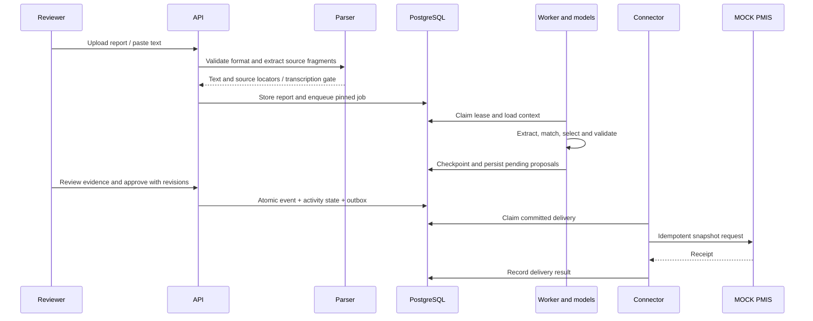

# Data flow

## Report to approved delivery

## Storage and failure boundaries

| Boundary | Stored evidence | Failure behavior |
|---|---|---|
| Intake | Original file record, report, fragments and mapping provenance | Reject invalid formats; missing PDF text requires reviewed transcription |
| Analysis | Pinned job, graph checkpoint, task/call records and pending proposals | Retain bounded failure state; retries preserve budgets and lineage |
| Review | Actor, revisions, approved effects and event history | Conflicts or invalid scope prevent commit |
| Ledger/outbox | Activity state and immutable delivery snapshot | Same application transaction; no delivery of uncommitted changes |
| External delivery | Attempts, status, errors and receipt | Retry transient failures; permanent failures block later activity revisions |

Original uploads are separate from PostgreSQL and must be backed up with it.
The receiver database is also separate: there is no distributed transaction across
application approval and remote delivery. Receiver idempotency makes retry after an
ambiguous network outcome safe within the mock contract.

## Conversation path

Supervisor messages produce drafts and clarification. With hierarchy enabled, new
conversations use durable worker tasks and model-call journals; otherwise analysis
is synchronous through the API. Confirmation prepares the review workflow; final
ledger authority remains with authenticated reviewer approval. Source dates,
clarification and run identities must remain traceable.

See [architecture](AGENT_ARCHITECTURE.md), [entities](DATA_MODEL.md),
[integrations](INTEGRATIONS.md) and [API](API_REFERENCE.md).

---

[Documentation index](README.md) · [Project overview](../README.md)
