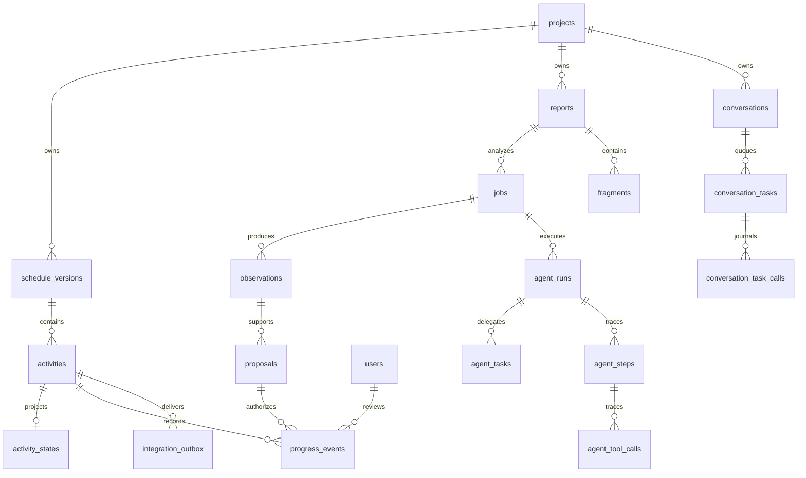

# Data model

PostgreSQL is the application source of truth. Uploaded bytes live separately
under `UPLOAD_DIR`; file records retain their application identity. The mock PMIS
receiver uses its own SQLite store and is outside application transactions.

## Core entity relationships

This overview omits secondary foreign keys for readability. The field reference
below lists all mapped tables and foreign keys, including nullable relationships.

## Persistence and audit semantics

Schedules are versioned; a project points at its active version. Jobs pin a version.
An observation describes reported work; a proposal carries the suggested activity
and effects. Neither is approved progress. Reviewer approval writes progress
history, updates activity state and enqueues a delivery snapshot transactionally.
Corrections and retractions retain event lineage rather than silently replacing
original history. Revision checks prevent stale approval. Idempotency keys protect
supported repeated mutations; they are not blanket deduplication for every API.
Audit events retain actor/action context. Reports can retain parent-job lineage
for reasoned reanalysis. Conversation journals and graph checkpoints support
recovery rather than granting approval authority.

## Migrations

Use `make migrate` after a database backup and before starting upgraded workers.
Alembic migrations are ordered in [backend/migrations/versions](../backend/migrations/versions/).
Do not edit applied historical migrations or infer safe downgrade from the existence
of a downgrade function. Rehearse changes against a restored isolated database.
LangGraph checkpoint persistence is also managed by runtime initialization; its
internal tables are not all part of the SQLAlchemy entity reference below.

## Entity reference

Generated from [models.py](../backend/app/db/models.py), excluding external
checkpoint-library tables. `?` marks nullable columns. Foreign-key details are
listed separately from type names. Consult migrations for constraints and indexes.

### `projects`

| Column | Type | References |
|---|---|---|
| `id` | `CHAR(32)` (PK) |  |
| `name` | `VARCHAR(200)` |  |
| `timezone` | `VARCHAR(64)` |  |
| `active_schedule_version_id?` | `CHAR(32)` | `schedule_versions.id` |
| `created_at` | `DATETIME` |  |

### `schedule_versions`

| Column | Type | References |
|---|---|---|
| `id` | `CHAR(32)` (PK) |  |
| `project_id` | `CHAR(32)` | `projects.id` |
| `version_number` | `INTEGER` |  |
| `source_file_id?` | `CHAR(32)` |  |
| `content_sha256` | `VARCHAR(64)` |  |
| `state` | `VARCHAR(24)` |  |
| `created_at` | `DATETIME` |  |

### `activities`

| Column | Type | References |
|---|---|---|
| `id` | `CHAR(32)` (PK) |  |
| `schedule_version_id` | `CHAR(32)` | `schedule_versions.id` |
| `external_id` | `VARCHAR(200)` |  |
| `name` | `VARCHAR(500)` |  |
| `wbs` | `VARCHAR(500)` |  |
| `discipline` | `VARCHAR(40)` |  |
| `work_type` | `VARCHAR(60)` |  |
| `area?` | `VARCHAR(200)` |  |
| `asset_tags?` | `TEXT` |  |
| `aliases?` | `TEXT` |  |
| `is_leaf` | `BOOLEAN` |  |
| `measurement_basis` | `VARCHAR(30)` |  |
| `planned_quantity?` | `NUMERIC(18, 4)` |  |
| `unit?` | `VARCHAR(20)` |  |
| `baseline_date?` | `DATE` |  |
| `baseline_quantity?` | `NUMERIC(18, 4)` |  |
| `planned_start?` | `DATE` |  |
| `planned_finish?` | `DATE` |  |
| `actual_start?` | `DATE` |  |
| `actual_finish?` | `DATE` |  |

### `activity_embeddings`

| Column | Type | References |
|---|---|---|
| `activity_id` | `CHAR(32)` (PK) | `activities.id` |
| `model_revision` | `VARCHAR(255)` (PK) |  |
| `composed_text_hash` | `VARCHAR(64)` |  |
| `vector` | `JSON` |  |
| `created_at` | `DATETIME` |  |

### `activity_states`

| Column | Type | References |
|---|---|---|
| `activity_id` | `CHAR(32)` (PK) | `activities.id` |
| `revision` | `INTEGER` |  |
| `completed_quantity` | `NUMERIC(18, 4)` |  |
| `physical_percent?` | `NUMERIC(8, 4)` |  |
| `observed_status` | `VARCHAR(30)` |  |
| `actual_start?` | `DATE` |  |
| `actual_finish?` | `DATE` |  |
| `last_observed_date?` | `DATE` |  |
| `actual_start_time?` | `TIME` |  |
| `actual_finish_time?` | `TIME` |  |
| `actual_start_precision?` | `VARCHAR(10)` |  |
| `actual_finish_precision?` | `VARCHAR(10)` |  |
| `lifecycle_status?` | `VARCHAR(30)` |  |
| `lifecycle_source_version_id?` | `CHAR(32)` | `schedule_versions.id` |
| `lifecycle_start_event_id?` | `CHAR(32)` | `progress_events.id` |
| `lifecycle_finish_event_id?` | `CHAR(32)` | `progress_events.id` |

### `users`

| Column | Type | References |
|---|---|---|
| `id` | `CHAR(32)` (PK) |  |
| `username` | `VARCHAR(120)` |  |
| `password_hash` | `VARCHAR(255)` |  |
| `role` | `VARCHAR(20)` |  |
| `is_active` | `BOOLEAN` |  |
| `created_at` | `DATETIME` |  |

### `project_memberships`

| Column | Type | References |
|---|---|---|
| `project_id` | `CHAR(32)` (PK) | `projects.id` |
| `user_id` | `CHAR(32)` (PK) | `users.id` |

### `sessions`

| Column | Type | References |
|---|---|---|
| `token_hash` | `VARCHAR(64)` (PK) |  |
| `user_id` | `CHAR(32)` | `users.id` |
| `csrf_hash` | `VARCHAR(64)` |  |
| `expires_at` | `DATETIME` |  |
| `revoked_at?` | `DATETIME` |  |

### `files`

| Column | Type | References |
|---|---|---|
| `id` | `CHAR(32)` (PK) |  |
| `project_id` | `CHAR(32)` | `projects.id` |
| `original_filename` | `VARCHAR(255)` |  |
| `storage_key` | `VARCHAR(255)` |  |
| `sha256` | `VARCHAR(64)` |  |
| `mime_type` | `VARCHAR(120)` |  |
| `size` | `INTEGER` |  |
| `source_kind` | `VARCHAR(30)` |  |
| `uploader_id?` | `CHAR(32)` | `users.id` |

### `reports`

| Column | Type | References |
|---|---|---|
| `id` | `CHAR(32)` (PK) |  |
| `project_id` | `CHAR(32)` | `projects.id` |
| `file_id?` | `CHAR(32)` | `files.id` |
| `report_date?` | `DATE` |  |
| `report_date_evidence?` | `TEXT` |  |
| `source_label?` | `VARCHAR(255)` |  |
| `source_revision?` | `VARCHAR(100)` |  |
| `ingestion_metadata?` | `JSON` |  |
| `content_hash` | `VARCHAR(64)` |  |
| `parsing_warnings?` | `TEXT` |  |
| `created_at` | `DATETIME` |  |

### `jobs`

| Column | Type | References |
|---|---|---|
| `id` | `CHAR(32)` (PK) |  |
| `project_id` | `CHAR(32)` | `projects.id` |
| `report_id` | `CHAR(32)` | `reports.id` |
| `parent_job_id?` | `CHAR(32)` | `jobs.id` |
| `reanalysis_key?` | `VARCHAR(200)` |  |
| `reanalysis_actor_id?` | `CHAR(32)` | `users.id` |
| `reanalysis_reason?` | `TEXT` |  |
| `config_snapshot?` | `JSON` |  |
| `schedule_version_id` | `CHAR(32)` | `schedule_versions.id` |
| `state` | `VARCHAR(32)` |  |
| `stage?` | `VARCHAR(32)` |  |
| `attempts` | `INTEGER` |  |
| `lease_token?` | `VARCHAR(64)` |  |
| `lease_expires_at?` | `DATETIME` |  |
| `heartbeat_at?` | `DATETIME` |  |
| `error_code?` | `VARCHAR(100)` |  |
| `error_message?` | `TEXT` |  |
| `model_version?` | `VARCHAR(200)` |  |
| `prompt_version?` | `VARCHAR(200)` |  |
| `config_version?` | `VARCHAR(200)` |  |
| `extracted_count` | `INTEGER` |  |
| `proposal_count` | `INTEGER` |  |
| `created_at` | `DATETIME` |  |
| `updated_at` | `DATETIME` |  |

### `agent_runs`

| Column | Type | References |
|---|---|---|
| `id` | `CHAR(32)` (PK) |  |
| `job_id` | `CHAR(32)` | `jobs.id` |
| `graph_version` | `VARCHAR(100)` |  |
| `state_schema_version` | `VARCHAR(100)` |  |
| `framework_version` | `VARCHAR(100)` |  |
| `thread_id` | `VARCHAR(255)` |  |
| `execution_mode` | `VARCHAR(16)` |  |
| `state` | `VARCHAR(32)` |  |
| `current_node?` | `VARCHAR(64)` |  |
| `counters` | `JSON` |  |
| `model_metadata` | `JSON` |  |
| `prompt_metadata` | `JSON` |  |
| `config_metadata` | `JSON` |  |
| `started_at` | `DATETIME` |  |
| `updated_at` | `DATETIME` |  |
| `completed_at?` | `DATETIME` |  |
| `error_code?` | `VARCHAR(100)` |  |
| `error_message?` | `VARCHAR(1000)` |  |

### `agent_tasks`

| Column | Type | References |
|---|---|---|
| `id` | `CHAR(32)` (PK) |  |
| `run_id` | `CHAR(32)` | `agent_runs.id` |
| `parent_task_id?` | `CHAR(32)` | `agent_tasks.id` |
| `agent_role` | `VARCHAR(32)` |  |
| `project_id` | `CHAR(32)` | `projects.id` |
| `source_id` | `CHAR(32)` |  |
| `schedule_version_id` | `CHAR(32)` | `schedule_versions.id` |
| `observation_key?` | `VARCHAR(100)` |  |
| `attempt` | `INTEGER` |  |
| `contract_version` | `VARCHAR(80)` |  |
| `input_fingerprint` | `VARCHAR(64)` |  |
| `input_references` | `JSON` |  |
| `output_references` | `JSON` |  |
| `evidence_references` | `JSON` |  |
| `warnings` | `JSON` |  |
| `actual_usage` | `JSON` |  |
| `safe_summary` | `JSON` |  |
| `status` | `VARCHAR(16)` |  |
| `outcome?` | `VARCHAR(32)` |  |
| `error_code?` | `VARCHAR(100)` |  |
| `started_at` | `DATETIME` |  |
| `finished_at?` | `DATETIME` |  |

### `agent_steps`

| Column | Type | References |
|---|---|---|
| `id` | `CHAR(32)` (PK) |  |
| `run_id` | `CHAR(32)` | `agent_runs.id` |
| `ordinal` | `INTEGER` |  |
| `node` | `VARCHAR(64)` |  |
| `attempt` | `INTEGER` |  |
| `state` | `VARCHAR(16)` |  |
| `input_hash?` | `VARCHAR(64)` |  |
| `output_hash?` | `VARCHAR(64)` |  |
| `sanitized_summary` | `JSON` |  |
| `started_at` | `DATETIME` |  |
| `finished_at?` | `DATETIME` |  |
| `duration_ms?` | `INTEGER` |  |
| `error_code?` | `VARCHAR(100)` |  |
| `error_message?` | `VARCHAR(1000)` |  |

### `agent_tool_calls`

| Column | Type | References |
|---|---|---|
| `id` | `CHAR(32)` (PK) |  |
| `step_id` | `CHAR(32)` | `agent_steps.id` |
| `tool_name` | `VARCHAR(100)` |  |
| `attempt` | `INTEGER` |  |
| `state` | `VARCHAR(16)` |  |
| `sanitized_input_summary` | `JSON` |  |
| `sanitized_output_summary` | `JSON` |  |
| `started_at` | `DATETIME` |  |
| `finished_at?` | `DATETIME` |  |
| `duration_ms?` | `INTEGER` |  |
| `error_code?` | `VARCHAR(100)` |  |
| `error_message?` | `VARCHAR(1000)` |  |

### `fragments`

| Column | Type | References |
|---|---|---|
| `id` | `CHAR(32)` (PK) |  |
| `report_id` | `CHAR(32)` | `reports.id` |
| `ordinal` | `INTEGER` |  |
| `locator` | `VARCHAR(255)` |  |
| `original_text` | `TEXT` |  |
| `normalised_text` | `TEXT` |  |
| `normalisation_version` | `VARCHAR(30)` |  |
| `ocr_status` | `VARCHAR(30)` |  |

### `observations`

| Column | Type | References |
|---|---|---|
| `id` | `CHAR(32)` (PK) |  |
| `job_id` | `CHAR(32)` | `jobs.id` |
| `fragment_id?` | `CHAR(32)` | `fragments.id` |
| `ordinal` | `INTEGER` |  |
| `fields` | `JSON` |  |
| `field_evidence` | `JSON` |  |
| `created_at` | `DATETIME` |  |

### `proposals`

| Column | Type | References |
|---|---|---|
| `id` | `CHAR(32)` (PK) |  |
| `observation_id` | `CHAR(32)` | `observations.id` |
| `revision` | `INTEGER` |  |
| `project_id` | `CHAR(32)` | `projects.id` |
| `chosen_activity_id?` | `CHAR(32)` | `activities.id` |
| `candidates` | `JSON` |  |
| `mapping_state` | `VARCHAR(24)` |  |
| `match_strength` | `VARCHAR(24)` |  |
| `review_state` | `VARCHAR(24)` |  |
| `warnings` | `JSON` |  |
| `proposed_effects` | `JSON` |  |
| `base_activity_revision?` | `INTEGER` |  |
| `created_at` | `DATETIME` |  |

### `progress_events`

| Column | Type | References |
|---|---|---|
| `id` | `CHAR(32)` (PK) |  |
| `activity_id` | `CHAR(32)` | `activities.id` |
| `observation_id` | `CHAR(32)` | `observations.id` |
| `proposal_id` | `CHAR(32)` | `proposals.id` |
| `proposal_revision` | `INTEGER` |  |
| `approved_values` | `JSON` |  |
| `effect_kind` | `VARCHAR(32)` |  |
| `effective_date?` | `DATE` |  |
| `reviewer_id` | `CHAR(32)` | `users.id` |
| `approved_at` | `DATETIME` |  |
| `supersedes_event_id?` | `CHAR(32)` | `progress_events.id` |
| `source_key?` | `VARCHAR(255)` |  |
| `lifecycle_scope?` | `VARCHAR(30)` |  |
| `endpoint_time?` | `TIME` |  |
| `endpoint_precision?` | `VARCHAR(10)` |  |
| `endpoint_timezone?` | `VARCHAR(64)` |  |
| `endpoint_basis?` | `VARCHAR(40)` |  |
| `endpoint_raw_expression?` | `VARCHAR(500)` |  |
| `endpoint_instant?` | `DATETIME` |  |
| `endpoint_evidence?` | `JSON` |  |
| `source_schedule_version_id?` | `CHAR(32)` | `schedule_versions.id` |

### `schedule_imports`

| Column | Type | References |
|---|---|---|
| `id` | `CHAR(32)` (PK) |  |
| `project_id` | `CHAR(32)` | `projects.id` |
| `file_id` | `CHAR(32)` | `files.id` |
| `source_format` | `VARCHAR(20)` |  |
| `parser_version` | `VARCHAR(100)` |  |
| `selected_source_project_id?` | `VARCHAR(255)` |  |
| `preview` | `JSON` |  |
| `revision` | `INTEGER` |  |
| `state` | `VARCHAR(24)` |  |
| `error_code?` | `VARCHAR(100)` |  |
| `creator_id?` | `CHAR(32)` | `users.id` |
| `reviewed_mapping?` | `JSON` |  |
| `mapped_content_hash?` | `VARCHAR(64)` |  |
| `staged_schedule_version_id?` | `CHAR(32)` | `schedule_versions.id` |
| `created_at` | `DATETIME` |  |

### `schedule_source_metadata`

| Column | Type | References |
|---|---|---|
| `schedule_version_id` | `CHAR(32)` (PK) | `schedule_versions.id` |
| `schedule_import_id` | `CHAR(32)` | `schedule_imports.id` |
| `source_project_id` | `VARCHAR(255)` |  |
| `source_file_hash` | `VARCHAR(64)` |  |
| `parser_version` | `VARCHAR(100)` |  |
| `reviewed_mapping` | `JSON` |  |
| `mapping_hash` | `VARCHAR(64)` |  |
| `task_metadata` | `JSON` |  |
| `wbs` | `JSON` |  |
| `relationships` | `JSON` |  |
| `source_metadata` | `JSON` |  |

### `audit_events`

| Column | Type | References |
|---|---|---|
| `id` | `CHAR(32)` (PK) |  |
| `actor_id` | `CHAR(32)` | `users.id` |
| `action` | `VARCHAR(64)` |  |
| `target_type` | `VARCHAR(64)` |  |
| `target_id` | `CHAR(32)` |  |
| `before?` | `JSON` |  |
| `after?` | `JSON` |  |
| `reason?` | `TEXT` |  |
| `request_id?` | `VARCHAR(255)` |  |
| `timestamp` | `DATETIME` |  |

### `idempotency_keys`

| Column | Type | References |
|---|---|---|
| `id` | `CHAR(32)` (PK) |  |
| `actor_id` | `CHAR(32)` | `users.id` |
| `endpoint` | `VARCHAR(120)` |  |
| `key` | `VARCHAR(255)` |  |
| `request_hash` | `VARCHAR(64)` |  |
| `result_reference?` | `JSON` |  |
| `status` | `VARCHAR(24)` |  |
| `created_at` | `DATETIME` |  |

### `conversations`

| Column | Type | References |
|---|---|---|
| `id` | `CHAR(32)` (PK) |  |
| `project_id` | `CHAR(32)` | `projects.id` |
| `creator_id` | `CHAR(32)` | `users.id` |
| `schedule_version_id` | `CHAR(32)` | `schedule_versions.id` |
| `revision` | `INTEGER` |  |
| `status` | `VARCHAR(30)` |  |
| `draft` | `JSON` |  |
| `pending_question?` | `VARCHAR(30)` |  |
| `job_id?` | `CHAR(32)` | `jobs.id` |
| `created_at` | `DATETIME` |  |
| `updated_at` | `DATETIME` |  |

### `conversation_turns`

| Column | Type | References |
|---|---|---|
| `id` | `CHAR(32)` (PK) |  |
| `conversation_id` | `CHAR(32)` | `conversations.id` |
| `ordinal` | `INTEGER` |  |
| `actor_id?` | `CHAR(32)` | `users.id` |
| `role` | `VARCHAR(20)` |  |
| `text` | `TEXT` |  |
| `created_at` | `DATETIME` |  |

### `integration_outbox`

| Column | Type | References |
|---|---|---|
| `id` | `CHAR(32)` (PK) |  |
| `project_id` | `CHAR(32)` | `projects.id` |
| `activity_id` | `CHAR(32)` | `activities.id` |
| `state_revision` | `INTEGER` |  |
| `payload` | `JSON` |  |
| `status` | `VARCHAR(20)` |  |
| `attempts` | `INTEGER` |  |
| `created_at` | `DATETIME` |  |
| `attempted_at?` | `DATETIME` |  |
| `next_attempt_at?` | `DATETIME` |  |
| `delivered_at?` | `DATETIME` |  |
| `last_error?` | `TEXT` |  |
| `receipt?` | `JSON` |  |

### `report_mappings`

| Column | Type | References |
|---|---|---|
| `id` | `CHAR(32)` (PK) |  |
| `project_id` | `CHAR(32)` | `projects.id` |
| `template` | `VARCHAR(100)` |  |
| `header_signature` | `VARCHAR(64)` |  |
| `revision` | `INTEGER` |  |
| `spec` | `JSON` |  |
| `actor_id` | `CHAR(32)` | `users.id` |
| `created_at` | `DATETIME` |  |

### `conversation_tasks`

| Column | Type | References |
|---|---|---|
| `id` | `CHAR(32)` (PK) |  |
| `conversation_id` | `CHAR(32)` | `conversations.id` |
| `schedule_version_id` | `CHAR(32)` | `schedule_versions.id` |
| `input_revision` | `INTEGER` |  |
| `version` | `VARCHAR(40)` |  |
| `input_fingerprint` | `VARCHAR(64)` |  |
| `config` | `JSON` |  |
| `state` | `VARCHAR(16)` |  |
| `attempts` | `INTEGER` |  |
| `model_calls` | `INTEGER` |  |
| `lease_token?` | `VARCHAR(64)` |  |
| `lease_expires_at?` | `DATETIME` |  |
| `next_attempt_at` | `DATETIME` |  |
| `deadline_at` | `DATETIME` |  |
| `error_code?` | `VARCHAR(80)` |  |
| `created_at` | `DATETIME` |  |

### `conversation_task_calls`

| Column | Type | References |
|---|---|---|
| `id` | `CHAR(32)` (PK) |  |
| `task_id` | `CHAR(32)` | `conversation_tasks.id` |
| `ordinal` | `INTEGER` |  |
| `role` | `VARCHAR(20)` |  |
| `input_fingerprint` | `VARCHAR(64)` |  |
| `result?` | `JSON` |  |

### `hosted_provider_admission`

| Column | Type | References |
|---|---|---|
| `provider` | `VARCHAR(20)` (PK) |  |
| `owner?` | `VARCHAR(36)` |  |
| `lease_expires_at?` | `DATETIME` |  |
| `state` | `JSON` |  |

---

[Documentation index](README.md) · [Project overview](../README.md)
