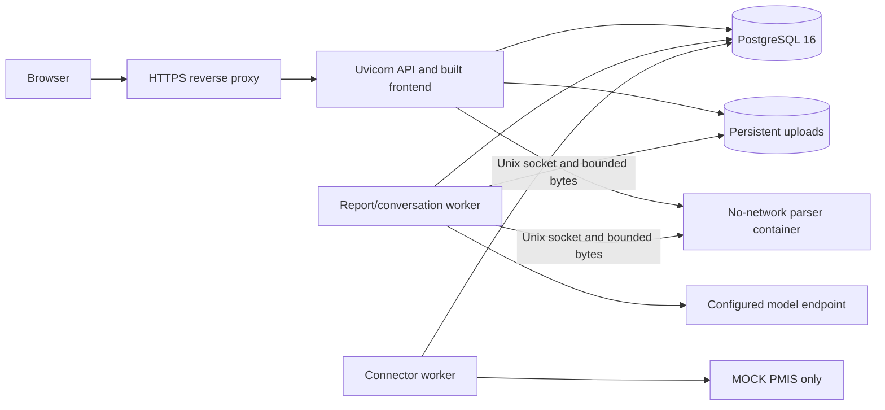

# Deployment and production prerequisites

> This is a deployment planning/runbook reference, not production certification.
> Representative quality, sustained capacity and release acceptance remain incomplete.

## Topology



## Prepare and start

1. Install Docker Engine with Compose, or Docker Desktop using Linux containers.
   Copy `.env.example` to `.env` if no private environment file exists. Configure
   provider/model settings, a random secret, and `ENVIRONMENT=production` for shared
   deployments. Production requires a random secret of at least 32 characters.
2. Build the image and start storage plus the isolated parser:

   ```sh
   docker compose build parser
   docker compose up -d --wait db parser
   ```

3. Keep `REGISTRATION_ENABLED=false` and restrict network access to the intended
   users. Registration defaults to disabled in production. Explicitly enabling it
   creates reviewer accounts and private workspaces.
4. Back up existing database/upload volumes and apply migrations before starting
   the updated API and workers:

   ```sh
   docker compose run --rm --no-deps api alembic upgrade head
   docker compose up -d api worker
   ```

   Migration `0019_login_throttle` is required for sign-in. Every API worker must
   use the same database and secret. The Compose database credentials are local
   development defaults; use restricted private credentials for shared deployment.
5. Expose the loopback API port through an HTTPS reverse proxy. Keep the parser's
   no-network, read-only, non-root and resource restrictions intact. It has no
   provider keys, application secret, uploads, host bind mounts or Docker socket.
   See [parser security](SECURITY.md#document-parser-confinement).
6. If using Ollama on the Docker host, set `OLLAMA_BASE_URL` to a reachable host
   endpoint (for Docker Desktop, usually `http://host.docker.internal:11434`).
   Container loopback refers to the container itself. Hosted providers use the
   configured API/worker credentials; those credentials never reach the parser.
7. Verify sign-in, import, analysis, review, approval, exports and restore recovery.
   Run the [Docker confinement tests](SECURITY.md#deployment-controls-and-verification).
   Record the tested revision/configuration. Do not infer capacity from liveness.
   A real PMIS still requires a separately implemented and accepted adapter.

The Dockerfile builds the frontend and installs Python/Java inside the image; the
host does not need matching language runtimes. Native host development still
requires the [local toolchain](local-run.md), and document parsing requires access
to the parser socket. Run API/worker containers to share that socket portably;
Docker Desktop named-volume Unix sockets are not host filesystem sockets.

## Reverse proxy requirements

Terminate TLS, preserve the host and original request scheme, restrict trusted
forwarders, and forward cookies plus CSRF headers. Set request-body limits aligned
with the supported 10 MiB input and multipart overhead. Configure timeouts for
actual routes: some conversation work remains synchronous unless durable mode is
selected. Serve the browser and API on the same origin unless a reviewed cross-origin
configuration is implemented. `/docs` and `/openapi.json` are enabled by default;
restrict exposure if required. No proxy or service-manager template is installed
by this documentation.

## Backup, recovery and upgrades

Use the quiesced `make backup` and isolated `make restore-verify` procedures in the
[local runbook](local-run.md). Preserve upload bytes alongside database state, and
back up the mock receiver separately. Set a retention policy, access controls and
restore-drill schedule appropriate to the deployment. Do not publish backup artifacts.
Before rollback, assess database compatibility and [pinned run identity](durable-model-configuration.md).
Do not resume old work by deleting checkpoints or resetting consumed budgets.

## Monitoring and acceptance

`/api/v1/health/live` reports process liveness only; there is no readiness endpoint.
Check database connectivity, queue age, leases, failure codes, provider admission,
upload disk space and outbox backlog separately. See [observability](OBSERVABILITY.md).
A release decision still needs measured workload, security and model-quality evidence;
read [testing and quality](TESTING_AND_QUALITY.md) before making availability promises.

---

[Documentation index](README.md) · [Project overview](../README.md)
