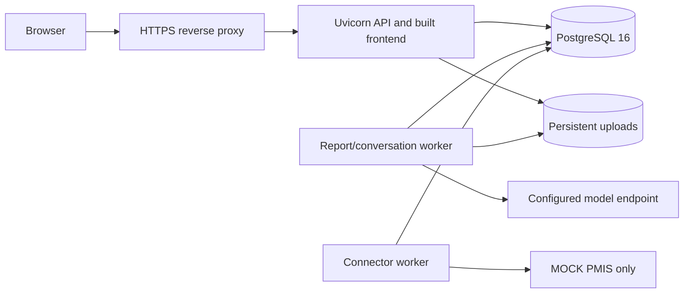

# Deployment and production prerequisites

> This is a deployment planning/runbook reference, not production certification.
> Representative quality, sustained capacity and release acceptance remain incomplete.

## Topology

## Prepare and start

1. Install Python 3.12, Node 20-compatible build tooling, PostgreSQL 16 and Java
   for native schedule parsing. Follow [local setup](local-run.md).
2. Build the frontend and install locked dependencies. Store secrets outside Git.
   Set `ENVIRONMENT=production`, a random `SECRET_KEY`, `DATABASE_URL`, persistent
   `UPLOAD_DIR` and reviewed provider/model settings. See [configuration](CONFIGURATION.md).
3. Restrict registration and network access according to the intended user population.
   Current self-registration creates reviewer accounts and projects.
4. Back up the existing database and uploads. Apply `make migrate` while intake and
   affected workers are quiesced. Rehearse against an isolated restore first.
5. Run `make serve PORT=8001` and `make worker` under the host's service supervisor,
   with restart limits and separate logs. The API binds loopback; expose it through HTTPS.
6. Start the connector only for an explicitly configured mock destination. A real PMIS
   requires a separately implemented and accepted adapter.
7. Verify sign-in, import, analysis, review, approval, exports and restore recovery.
   Record the tested revision and configuration. Do not infer capacity from liveness.

## Reverse proxy requirements

Terminate TLS, preserve the host and original request scheme, restrict trusted
forwarders, and forward cookies plus CSRF headers. Set request-body limits aligned
with the supported 10 MiB input and multipart overhead. Configure timeouts for
actual routes: some conversation work remains synchronous unless durable mode is
selected. Serve the browser and API on the same origin unless a reviewed cross-origin
configuration is implemented. `/docs` and `/openapi.json` are enabled by default;
restrict exposure if required. No proxy or service-manager template is installed
by this documentation.

## Backup, recovery and upgrades

Use the quiesced `make backup` and isolated `make restore-verify` procedures in the
[local runbook](local-run.md). Preserve upload bytes alongside database state, and
back up the mock receiver separately. Set a retention policy, access controls and
restore-drill schedule appropriate to the deployment. Do not publish backup artifacts.
Before rollback, assess database compatibility and [pinned run identity](durable-model-configuration.md).
Do not resume old work by deleting checkpoints or resetting consumed budgets.

## Monitoring and acceptance

`/api/v1/health/live` reports process liveness only; there is no readiness endpoint.
Check database connectivity, queue age, leases, failure codes, provider admission,
upload disk space and outbox backlog separately. See [observability](OBSERVABILITY.md).
A release decision still needs measured workload, security and model-quality evidence;
read [testing and quality](TESTING_AND_QUALITY.md) before making availability promises.

---

[Documentation index](README.md) · [Project overview](../README.md)
