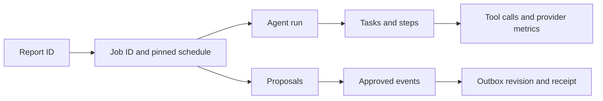

# Observability and diagnostics

## Follow a report

| Question | Evidence |
|---|---|
| Is the process alive? | `GET /api/v1/health/live` |
| Is local configuration usable? | `make doctor`; `ops/runtime_status.py` |
| Where did a report stop? | Job state/stage/error, attempts and timestamps |
| What did the graph do? | `GET /api/v1/jobs/{job_id}/agent-run` and run/step/task records |
| What source/configuration ran? | Pinned source/settings/prompt identities and run metadata |
| Is external delivery delayed? | Project integration-deliveries endpoint and outbox attempts/status |

Trace summaries are sanitized and bounded to 64 KiB. They retain counts, state
hashes, timings, error codes and available provider metrics rather than full private
inputs. Do not paste private source reports, credentials or raw provider responses
into public logs/issues. Checkpoint data may contain more sensitive state than traces.

## Latency, usage and cost

Separate queue delay, provider admission wait, request latency, graph duration,
review time and delivery latency. A completed HTTP request alone is not an end-to-end
success metric. Usage and cost are only known when supported evidence exists;
missing token/cache/spend fields stay unknown rather than zero. Published model
studies are small development comparisons, not sustained service guarantees.

## Failure triage

1. Identify project, report, job and schedule IDs plus the deployed revision.
2. Read the safe error code and stage; distinguish parsing, transcription,
   provider admission, model/schema, evidence, scope and ownership failures.
3. Inspect worker logs and sanitized run telemetry. Verify original deadlines,
   remaining budgets and pinned configuration before retrying.
4. For approval conflicts, reload current revisions. For outbox errors, inspect the
   failed earlier activity revision and receiver receipt before further delivery.
5. Record a sanitized reproduction and outcome; retain original failure evidence.

No Prometheus/Grafana stack, alert delivery or readiness endpoint is shipped.
Operators must configure monitoring and retention for their hosting environment.
See [troubleshooting](TROUBLESHOOTING.md), [testing](TESTING_AND_QUALITY.md) and
[telemetry implementation](../backend/app/agent/telemetry.py).

## Provider failures and coverage

Planner calls are recorded through the same durable tool telemetry as specialist
calls. Groq output failures distinguish `MODEL_OUTPUT_TRUNCATED`,
`MODEL_JSON_INVALID`, `MODEL_SCHEMA_MISMATCH`, `MODEL_REFUSED` and
`MODEL_ENVELOPE_INVALID`. HTTP rejection remains `MODEL_REQUEST_FAILED`;
daily quotas use `MODEL_QUOTA_EXHAUSTED`. Failed extraction/selection jobs retain
the failing operation as their stage rather than always reporting persistence.

Groq/OpenRouter numeric provider metrics retain HTTP-status counts, allowlisted
error/finish labels and bounded numeric quota diagnostics. Provider messages,
failed generations and credentials are not retained in those metrics. Gonka
currently has no entry in this numeric collector; the standalone comparison's
safe call audit is separate evidence and does not imply durable metric coverage.

---

[Documentation index](README.md) · [Project overview](../README.md)
