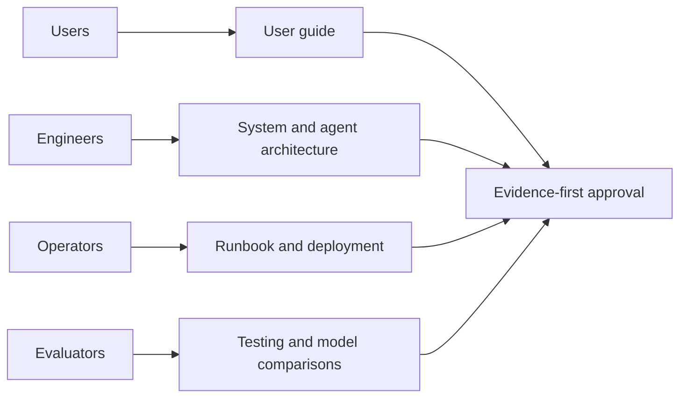

# Documentation

Time Agent turns construction reports into evidence-backed progress proposals.
This is a local prototype with mock PMIS delivery; production acceptance remains
incomplete. Start with the [project quick start](../README.md).

## Use the application

| Guide | Contents |
|---|---|
| [User Guide](USER_GUIDE.md) | Illustrated import, review, approval and export workflow |
| [Document Input Capabilities](document-input-capabilities.md) | Supported formats, parser limits and transcription |
| [Schedule Matching](SCHEDULE_MATCHING.md) | Candidates, evidence, abstention and corrections |
| [Troubleshooting](TROUBLESHOOTING.md) | Common failures and recovery checks |

## Understand the system

| Guide | Contents |
|---|---|
| [System](SYSTEM.md) | System overview and source map |
| [Agent Architecture](AGENT_ARCHITECTURE.md) | LangGraph, supervisors, tools and checkpoints |
| [Data Flow](DATA_FLOW.md) | Upload to ledger and delivery |
| [Data Model](DATA_MODEL.md) | ER diagram, entities, fields and migrations |
| [Api Reference](API_REFERENCE.md) | Endpoints, authentication, schemas and examples |
| [Integrations](INTEGRATIONS.md) | Schedule readers, PMIS adapter and mock boundaries |

## Run and secure it

| Guide | Contents |
|---|---|
| [Local Run](local-run.md) | Local setup, operation, backup and restore |
| [Configuration](CONFIGURATION.md) | All settings and defaults |
| [Deployment](DEPLOYMENT.md) | Hosting prerequisites and deployment sequence |
| [Security](SECURITY.md) | Authentication, authorization and threat model |
| [Observability](OBSERVABILITY.md) | Traces, latency, usage and diagnosis |
| [Provider Capacity](provider-capacity.md) | Provider admission, account scopes and quota |
| [Durable Model Configuration](durable-model-configuration.md) | Pinned identities and safe resumption |

## Evaluate models and prompts

| Guide | Contents |
|---|---|
| [Testing And Quality](TESTING_AND_QUALITY.md) | Verified software checks and acceptance limits |
| [Evaluation Research Report](EVALUATION_RESEARCH_REPORT.md) | Research methods, results and limitations |
| [Model And Prompt Comparison Report](MODEL_AND_PROMPT_COMPARISON_REPORT.md) | Model and prompt comparison |
| [Model Quality Summary](MODEL_QUALITY_SUMMARY.md) | Quality and latency summary |
| [Model Prompt Catalog](MODEL_PROMPT_CATALOG.md) | Exact prompts |
| [Model Comparison Checklist](MODEL_COMPARISON_CHECKLIST.md) | Comparison coverage |
| [Model Generation Settings](model-generation-settings.md) | Request generation settings |
| [Stage Specification V1](stage-specification-v1.md) | Stage contracts |
| [Model Call Authority Inventory](model-call-authority-inventory.md) | Model authority inventory |
| [Readme](../evaluation/README.md) | Evaluation tools, contracts and fixtures |

## Contribute and track changes

| Guide | Contents |
|---|---|
| [Contributing](CONTRIBUTING.md) | Development workflow and verification |
| [Changelog](../CHANGELOG.md) | User-visible changes |
| [License](../LICENSE) | Proprietary terms; third-party licenses remain separate |

## Publication boundaries

All guides linked above are maintained for the remote repository. The
[OpenAPI snapshot](api-contract.json) is generated from the application.
Historical handoffs, raw captures, operator notes, private uploads and detailed
execution archives remain local and ignored. Research references labeled as local
archives are provenance descriptions, not downloadable public evidence.
