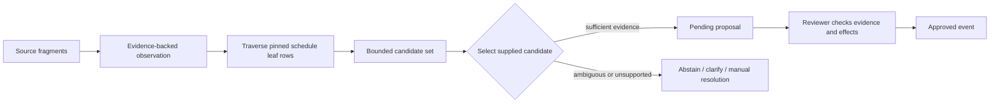

# Schedule matching and progress decisions

## Matching pipeline

The current runtime uses model-led discovery over the pinned schedule, not a
production embedding/hybrid retrieval pipeline. Historical embedding entities and
retrieval experiments do not establish the active matching algorithm.

## Hierarchy, scores and evidence

The matcher considers leaf activities, their schedule context and reported work.
Discovery uses bounded requests and retains at most eight candidates. Selection
must name a supplied in-scope candidate or abstain. Activity IDs outside the pinned
schedule cannot be accepted. Work type, location, asset tags, units and source
wording must be assessed together; a similar description alone is not proof.

Candidate scores and confidence are diagnostic model outputs, not calibrated
probabilities or permission to approve automatically. There is no universal
published confidence cutoff that establishes correctness. Preserve source locators
and exact quoted evidence; missing fields must not be invented to make a match.
See [confidence contract](../evaluation/contracts/confidence-calibration.md).

## Reviewer resolution and corrections

Inspect the source and candidate activity, resolve ambiguity, and revise unsupported
fields before approval. Use current proposal/activity revisions and an idempotency
key. Schedule activation can invalidate pending proposals; reanalysis does not
rewrite previously approved history. Accepted progress changes use the audited
correction/retraction APIs. Quantity, percentage, lifecycle and blocker effects
have separate validation and history semantics.

Relevant code: [agent tools](../backend/app/agent/tools.py),
[selection schemas](../backend/app/schemas/matching.py),
[review endpoints](../backend/app/api/endpoints/review.py) and
[ledger](../backend/app/progress/ledger.py).

---

[Documentation index](README.md) · [Project overview](../README.md)
