# Security and threat model

> Scope: local public/synthetic prototype. Production acceptance remains incomplete.

## Reporting vulnerabilities

Do not put credentials, private reports or exploit details in public issues.
No private security contact is configured in this repository. Use GitHub private
vulnerability reporting if the repository owner has enabled it; otherwise request
a private reporting channel without disclosing the vulnerability publicly.

## Trust boundaries

```mermaid
flowchart LR
    U[Browser and untrusted uploads] -->|session and CSRF| A[API authorization]
    A --> P[Isolated Docker parser service]
    P --> T[Untrusted extracted text]
    T --> L[Configured model provider]
    L --> V[Schema, scope and evidence checks]
    V --> R[Pending review]
    R -->|authorized approval| D[Ledger and outbox]
    D --> C[Configured connector destination]
```



| Threat | Implemented boundary | Remaining responsibility or limitation |
|---|---|---|
| Session theft / forged writes | HttpOnly SameSite cookie, hashed session tokens, expiry/revocation, CSRF header; production rejects placeholder and short secrets | Terminate HTTPS and protect the deployment host |
| Password guessing | PBKDF2-SHA256 with random salt; PostgreSQL account/IP admission shared across workers and restarts; dummy password verification for unknown users | Targeted failures can temporarily block an account; edge limits are still needed against request floods |
| Unauthorized access | Membership and reviewer checks; evidence and activity scope validation | Review every new endpoint for equivalent checks |
| Unwanted account creation | Names/passwords validated; registration disabled by default in production | Explicitly enabling registration creates reviewers in their own workspace; restrict access before shared deployment |
| Malicious documents | Dedicated Docker service with no network, read-only root, non-root user, bounded scratch/resources and no service credentials | Keep the Docker runtime and parser image patched; container/kernel isolation remains trusted |
| Prompt injection | Fixed tool surface, strict schemas, source evidence/scope checks and legal actions; adversarial documents exercise these boundaries | Deterministic injected-response tests do not establish hosted-model robustness or semantic correctness |
| Cross-project references | Pinned schedules and source-fragment provenance validation | Continue checking stored model output on reads and writes |
| Duplicate or stale approval | Revisions, locks and supported idempotency controls | Clients must refresh after conflicts |
| Unsafe exports/downloads | CSV formula protection, confined download paths, attachment/nosniff behavior | Review every new rendering or export path |
| Sensitive data disclosure | Private environment files, sanitized bounded trace summaries; parser children do not inherit service credentials | Hosted models receive configured input; approve provider data handling before private data use |

## Shared login admission

Apply migration `0019_login_throttle` before starting the updated API. Admission
uses a short, separately committed PostgreSQL transaction with an advisory lock.
A failed login's request rollback cannot erase its reservation. All API workers
must use the same database and `SECRET_KEY`; there is no process-local fallback.
Database failures return a generic 503 without issuing a session cookie.

Within a five-minute window, the limiter admits:

- Five failed or pending password checks per case-folded username, across client IPs.
- Fifty attempts per client IP, across usernames, including successful attempts.

A successful password check releases only its own account reservation. Concurrent
failures and a newer account window remain intact. IP reservations remain counted.
Expired buckets are removed during admission. At most 10,000 live buckets are
stored; requests needing additional buckets receive 429 instead of evicting live
limits. Bucket keys are HMAC hashes, so raw usernames and IP addresses are not
stored in the throttle table. Rotating the secret changes bucket identities.

Keep an edge request limit for flood protection. Configure trusted proxy forwarding
so unrelated users do not all appear as the proxy IP; never trust arbitrary
client-supplied forwarding headers. Account limits can be abused for temporary
lockout, and shared NAT users share an IP budget.

## Document parser confinement

Report parsing, spreadsheet preview/mapping, and native schedule parsing run in
one dedicated Linux container on any supported Docker host, including Docker
Desktop on macOS and Windows. No host-specific sandbox tools or privileged
container settings are required. The supplied Docker Compose service enforces:

- `network_mode: none`, so the parser cannot reach provider APIs, the database,
  the internet, or other containers through IP networking.
- A read-only root filesystem, a non-root user, all capabilities dropped, and
  `no-new-privileges`; bounded memory, CPU and process counts.
- A 256 MiB temporary filesystem for scratch files. The only persistent mount is
  a dedicated Unix-socket volume shared with API/worker clients. Uploads, database
  storage, host paths and the Docker socket are not mounted into the parser.
- No application `.env`, database URL, provider keys or application secret in the
  parser environment or image. `.dockerignore` excludes private files and uploads.
  Parser child environments are explicitly constructed rather than inherited.

The API and workers send bounded document bytes over the Unix socket. The service
accepts only fixed report operations and fixed native-reader modules, stages native
input in private scratch space, and returns bounded structured results. It rejects
arbitrary commands, modules and filesystem paths. Requests, responses and transport
time are capped. Missing/unreachable service or failed parsing produces a safe
error; API/worker code never retries parsing locally.

Per-document input/container/dimension/output/time limits and supervised child
processes remain in force inside the container. Memory supervision includes
process descendants; the container also has a 2 GiB memory ceiling. Sampling
allows a finite overshoot window. Native JVM heap/metaspace limits remain in force.
Two concurrent requests are permitted; excess connections fail safely. This is a
bounded prototype configuration, not a measured production throughput guarantee.

Start the parser through Docker Compose. Running the internal parser-service
module directly on a host does not establish container isolation; its explicit
`PARSER_SERVICE_ISOLATED=1` startup marker is not a security mechanism. Do not
weaken the Compose restrictions or add host/credential mounts. Docker/kernel and
parser-runtime vulnerabilities remain residual risks. Ordinary report text and
model responses are still untrusted after parsing.

## Adversarial document coverage

The synthetic corpus in
[`prompt_injection.json`](../backend/tests/fixtures/security/prompt_injection.json)
contains instruction overrides, fabricated-evidence requests, credential-exfiltration
tool requests, forged role delimiters, and forged approval results. Tests generate
TXT, DOCX, XLSX and PDF files, parse them through fixed service dispatch, and check
that hostile content stays in the source-data channel while system instructions
and schemas remain fixed. Forged model responses exercise rejection of missing
quotes, foreign fragment references, approval fields and arbitrary tool calls.
The tests also check that these paths do not write progress to the ledger.

These tests inject model responses and make no provider calls. They demonstrate
application boundary enforcement, not that an LLM will always ignore an attack or
interpret a genuine construction report correctly. Representative adversarial
quality evaluation and human review remain required.

## Deployment controls and verification

Apply migration `0020_job_admission_retry` before deploying the updated API or
worker. Report admission scans at most 20 eligible jobs per poll. A cooled job
receives a persisted five-second retry time without spending an attempt; jobs
not yet checked are considered first so a larger cooled backlog cannot pin the
queue head. Idle worker polls commit these deferrals as well as exhausted-lease
cleanup. Successful claims and explicit retries clear the admission deferral.

Both schedule upload routes authenticate before parsing multipart input, then
enforce a 10 MiB file cap before spooling each part and an aggregate transfer cap
with 64 KiB allowance for multipart headers. Only one `upload` file and no extra
fields are accepted. Temporary files close on rejection, disconnect or cancelled
receipt. The baseline report graph also checks current ownership before and after
each model call, including calls inside one extraction/retrieval node. It cannot
interrupt an inference already in flight, but revoked work cannot initiate the
next call once cancellation is visible to its ownership check.

Production startup rejects the development/example secret and secrets shorter than
32 characters. Generate a random secret, use restricted database credentials,
protect uploads and backups, and keep provider keys server-side.
`ENVIRONMENT=production` enables Secure cookies; it does not establish HTTPS.
Registration defaults to disabled in production. `REGISTRATION_ENABLED=false`
disables it in any environment; `true` explicitly enables reviewer self-registration.
Existing accounts can still sign in.

Build and start the real isolated service, then run the container contract tests:

```sh
docker compose build parser
docker compose up -d --wait parser
PARSER_TEST_CONTAINER=$(docker compose ps -q parser) \
  .venv/bin/pytest -q backend/tests/container
```

The container suite inspects actual Docker restrictions, probes network/filesystem
denials, verifies independent client-container access through the shared socket,
and runs real report and JVM imports. Unit tests use explicit local service
dispatch to exercise parser supervision and adversarial model boundaries without
requiring Docker; they do not substitute for the container suite.

Run `backend/tests/integration/test_shared_login_limiter.py` against a migrated,
isolated PostgreSQL test database. It verifies independent worker processes,
failed-request rollback, and stale-success handling. CI runs both the Docker
container contract and PostgreSQL shared-limiter suites.

The model cannot approve progress, choose arbitrary network destinations or execute
shell commands. Native readers use fixed dispatch rather than model-selected code.
See [document limits](document-input-capabilities.md), [deployment](DEPLOYMENT.md)
and [testing limitations](TESTING_AND_QUALITY.md). Third-party dependency licenses
remain separate from the repository's [proprietary license](../LICENSE).

---

[Documentation index](README.md) · [Project overview](../README.md)
