# Security and threat model

> Scope: local public/synthetic prototype. Production acceptance remains incomplete.

## Reporting vulnerabilities

Do not put credentials, private reports or exploit details in public issues.
No private security contact is configured in this repository. Use GitHub private
vulnerability reporting if the repository owner has enabled it; otherwise request
a private reporting channel without disclosing the vulnerability publicly.

## Trust boundaries

```mermaid
flowchart LR
    U[Browser and untrusted uploads] -->|session and CSRF| A[API authorization]
    A --> P[Bounded parser child]
    P --> T[Untrusted extracted text]
    T --> L[Configured model provider]
    L --> V[Schema, scope and evidence checks]
    V --> R[Pending review]
    R -->|authorized approval| D[Ledger and outbox]
    D --> C[Configured connector destination]
```

| Threat | Implemented boundary | Residual concern |
|---|---|---|
| Session theft / forged writes | HttpOnly SameSite cookie, hashed session tokens, expiry/revocation, CSRF header | Require HTTPS and protect the deployment host |
| Password guessing | PBKDF2-SHA256 with random salt; five failures per five-minute window | Login throttle is process-local, not a distributed edge control |
| Unauthorized access | Membership and reviewer checks; evidence and activity scope validation | Review every new endpoint for equivalent checks |
| Unwanted account creation | Registration validates names/passwords | Registration currently creates reviewers; restrict access before shared deployment |
| Malicious documents | Format/container/dimension/output limits and bounded parser processes | Per-process limits are not complete filesystem/network confinement |
| Prompt injection | Model output is untrusted; fixed tools, schemas, evidence checks and legal actions | Model correctness and representative adversarial quality remain unproven |
| Cross-project references | Pinned schedules and source-fragment provenance validation | Stored model output must continue to be checked on reads and writes |
| Duplicate or stale approval | Revisions, locks and supported idempotency controls | Clients must refresh after conflicts |
| Unsafe exports/downloads | CSV formula protection, confined download paths, attachment/nosniff behavior | Review any new rendering or export path |
| Sensitive data disclosure | Private environment files; sanitized bounded trace summaries | Hosted models receive configured input; approve data handling before private data use |

## Operational controls

Replace the development secret, use restricted database credentials, protect uploads
and backups, and keep provider keys server-side. `ENVIRONMENT=production` enables
Secure cookies; it does not by itself establish a secure production deployment.
The model cannot approve progress, choose arbitrary network destinations or execute
shell commands. Native readers use fixed dispatch rather than model-selected code.

See [document limits](document-input-capabilities.md), [deployment](DEPLOYMENT.md)
and [testing limitations](TESTING_AND_QUALITY.md). Third-party dependency licenses
remain separate from the repository's [proprietary license](../LICENSE).

---

[Documentation index](README.md) · [Project overview](../README.md)
