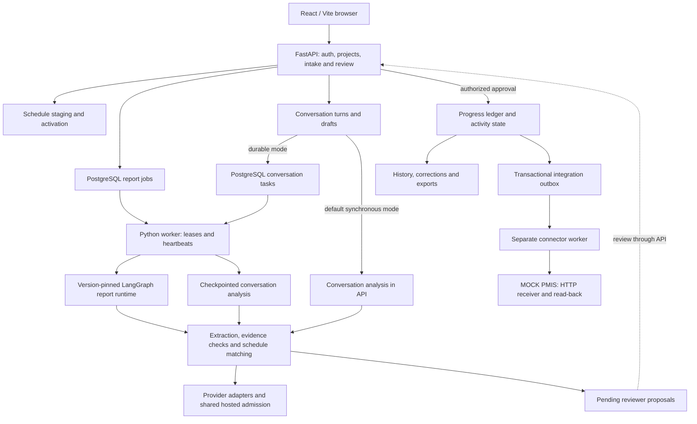

# System guide

Time Agent is a local construction-progress prototype. Reports and conversations
produce evidence-backed proposals for authorized review. Only approval commits
progress; the delivery integration targets **MOCK PMIS**, not a production PMIS.

## Architecture



PostgreSQL stores application state, report checkpoints, task/call journals, audit traces and hosted admission state. Uploaded source files are stored separately. The mock receiver maintains its own SQLite store. Database transactions do not span hosted admission waits or durable worker inference.

### Versioned report hierarchy

| Area | Default behavior | Optional hierarchical behavior |
|---|---|---|
| Reports | `report-analysis-v1`: bounded extraction → matching → review persistence graph | `report-analysis-v2`: root orchestrator with nested supervisor graphs |
| New conversations | Synchronous analysis through the API | `conversation-analysis-v1`: leased worker tasks and model-call journals |
| Supervisor routing | Deterministic | Optional model-assisted confirmation of the next legal supervisor action |
| Model assignments | Baseline provider/model for v1 reports | Pinned extraction, selection and optional orchestrator assignments |

The v2 report hierarchy is defined in [hierarchy.py](../backend/app/agent/hierarchy.py), with delegation rules in [registry.py](../backend/app/agent/registry.py):

```text
Root orchestrator
├── Intake supervisor
│   └── Clarification role registered for intake delegation
├── Analysis supervisor
│   ├── Extraction specialist
│   ├── Matching supervisor
│   │   └── Selection specialist
│   └── Evidence validation specialist
└── Review preparation supervisor → pending proposals
```

The current report intake graph loads context; conversation analysis provides user-facing clarification. These roles are scoped components inside the Python runtime, each with explicit contracts, budgets and permitted capabilities. Specialist execution is sequential; it does not require a separate server or model for each role. Multiple worker processes can claim independent jobs, but sustained capacity remains unproven.

`AGENT_HIERARCHY_ENABLED=true` selects v2 for new report runs and durable analysis for new conversations. Existing reports dispatch from their stored graph/state versions; existing durable conversations keep their journals. Disabling the flag changes subsequent work without rewriting in-flight records. There is one supported report execution engine: LangGraph.

`ORCHESTRATOR_MODEL_ASSISTED=false` keeps supervisor routing deterministic. The optional planner validates a supplied legal action; it does not freely invent workflows or approve progress. Supported planner assignments include Groq `openai/gpt-oss-120b` and the explicitly allowlisted OpenRouter free models in [planner.py](../backend/app/agent/planner.py). This planner configuration is separate from the local GPT-OSS 20B extraction profile.

### Extraction, matching and recovery

Extraction validates observations against the schema and exact source evidence. Matching traverses pinned leaf schedule rows in bounded model requests, retains at most eight candidates, then selects a supplied candidate or abstains. This is model-led discovery, rather than the older embedding/hybrid retrieval architecture.

The default extraction prompt is V12 (`extraction-v12-source-clause-check`). V20 (`extraction-v20-short-schedule-ids`) is an explicit candidate with request-local schedule aliases and conservative repeated-heading evidence repair. Starting the app or enabling the hierarchy does not automatically select V20. Saved prompts, role assignments and configuration preserve each run's provenance.

Report jobs use PostgreSQL checkpoints, ownership leases and independent heartbeats. Durable conversations reserve model-call budgets before inference and journal completed responses for validated replay. Both paths preserve pinned schedule scope. The model can prepare review proposals; authorized API approval controls ledger changes.


## Data and trust boundaries

Projects own schedule versions, reports, jobs, conversations and proposals.
A run pins its schedule version; matching cannot select an activity outside that
scope. Source locators and exact evidence support proposals. Review approval,
correction and retraction are authenticated application operations. Model output
cannot approve work, execute shell commands or choose network destinations.

PostgreSQL is the source of truth for the progress ledger, event history,
checkpoints and outbox. Original uploads live beneath the configured upload root.
The mock receiver uses a separate SQLite database. CSV/JSON exports reflect
committed ledger state; exports protect spreadsheet formula cells.

## Selected orchestrator configuration

The owner's selected local profile uses the V2 hierarchy with model-assisted
routing, Groq `openai/gpt-oss-120b` for orchestration on key slot 1, and
`openai/gpt-oss-20b` for extraction and selection on key slot 2. Each key belongs
to a different account. This describes the saved local configuration; a running
process must be inspected or restarted deliberately to load changes.
Checked-in rollout defaults remain disabled. See [setup](local-run.md).

Runs pin their source, dependencies, schema and model configuration. Changed or
unpinned legacy work stops before new inference. See
[durable configuration](durable-model-configuration.md) before recovery or upgrade.

## Source map

| Path | Responsibility |
|---|---|
| `backend/app/api` | Authenticated project, intake, job, conversation and review APIs |
| `backend/app/agent` | Versioned report graphs, hierarchy, role contracts and planning |
| `backend/app/conversation` | Conversation analysis and durable tasks |
| `backend/app/llm` | Provider adapters, budgets, admission and call configuration |
| `backend/app/ingest` | Report processing and native schedule readers |
| `backend/app/progress` | Approval ledger, lifecycle events and history |
| `backend/migrations` | Database migrations |
| `frontend/src` | React workspace and review UI |
| `ops` | Worker, connector, mock receiver, backup and diagnostics |
| `evaluation` | Study runners, offline scorers and reproducible fixtures |

See [document support](document-input-capabilities.md) for exact format limits,
[provider capacity](provider-capacity.md) for quotas, and
[testing](TESTING_AND_QUALITY.md) for verified behavior and open acceptance gates.
