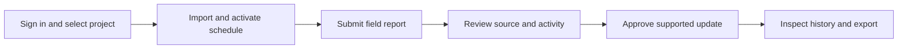
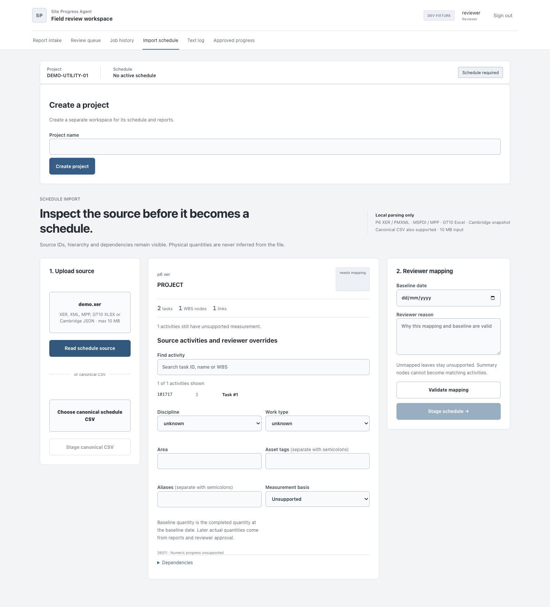
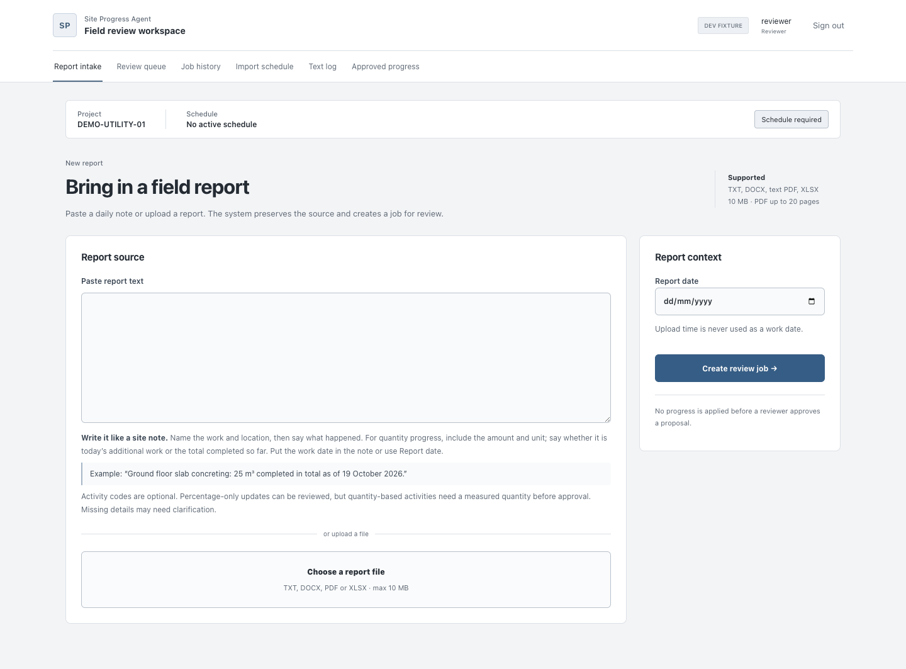
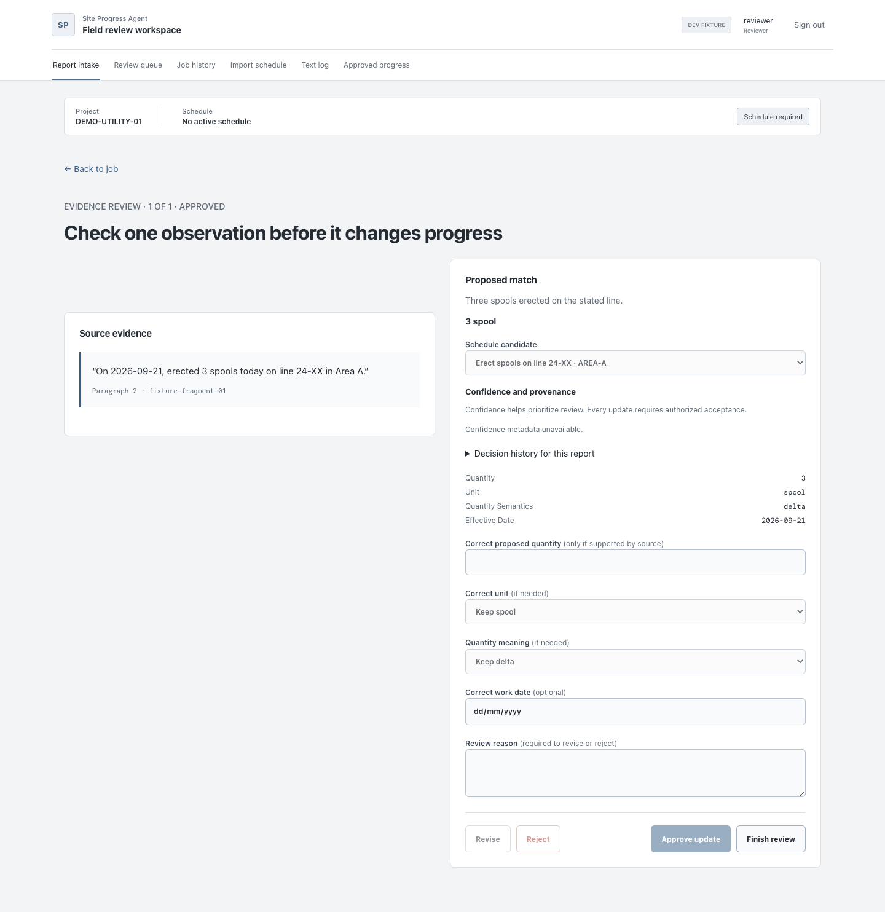
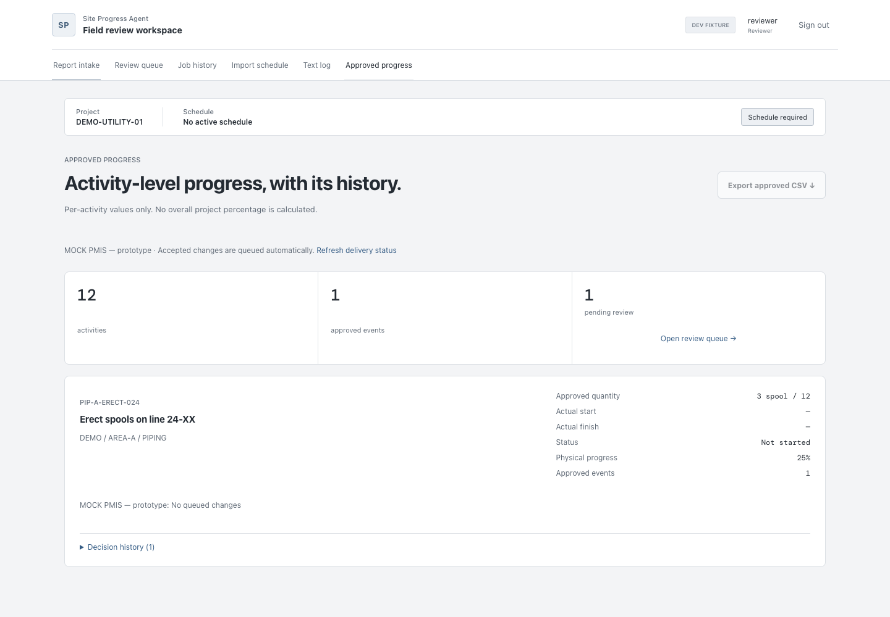

# User guide

Follow this workflow after an operator completes [setup](local-run.md).
Screenshots illustrate synthetic fixture mode; they do not establish live data or model accuracy.
The redesigned scheduling workspace is described below. They illustrate controls, not live parsing/model accuracy or
successful external delivery. Fixture headers may show “No active schedule” while
rendering canned review/progress data; a real workspace requires activation.
Fixture mode disables CSV export; actual downloads
require an authenticated API-backed workspace.

## 1. Sign in and select a project

Open the operator-provided application URL and sign in with your account. Confirm
the project and active schedule in the workspace header. Registration, where
available, creates a new project; ask the operator which project to use for shared
work. Do not submit private data to an unapproved model provider.

## Schedule workspace and project overview

Open **Overview** for counts of scheduled activities, accepted events, and pending
proposals. These are distinct measures, with no overall project completion metric.
Open **Schedule** to explore activities grouped by the imported WBS. Switch between
Timeline and Table with the rounded view control (arrow keys work when focused).
Search by activity name, code, or WBS; filter activities with or without accepted
updates. Large schedules display 50 activities per page.

Timeline bars use only imported planned start and finish dates. Undated rows stay
visible. Choose Fit schedule, 30 days, or 90 days and use the date arrows to explore.
This is a read-only view; it does not change schedule dates or dependencies.

Use the appearance button in navigation to switch between light and dark themes.
The selection is saved locally. Narrow screens use a horizontally scrollable
navigation strip; all controls retain accessible names and keyboard support.

## 2. Import and activate a schedule

Open **Import schedule**, upload a supported source, and choose **Read schedule
source**. Inspect source project, hierarchy and activities. Set required mapping
fields, baseline date and a reviewer reason, then choose **Validate mapping** and
**Stage schedule**. Staging does not activate it: explicitly activate the reviewed
version before report intake. Canonical CSV has a separate staging option.

Summary nodes cannot become matching activities. Do not invent planned quantities
or measurement bases from descriptions. If existing accepted progress prevents
activation, stop and ask the operator about schedule rebasing.

## 3. Submit field progress

Open **Report intake**. Paste text or choose a supported report file. State the work,
location, measured amount/unit and work date, and distinguish today's increment
from the cumulative total. Enter a report date only when supported by the source.
Choose **Create review job** and wait for the job state.

Mapped XLSX requires preview and confirmed column mapping. A PDF missing usable
text requires reviewed transcription; there is no automatic OCR. Use the evidence review controls to resolve activity matches and supported field values.
Neither submission nor analysis approval by a model commits progress.

## 4. Review evidence and resolve ambiguity

Open the review queue. Compare the quoted source and locator with the proposed
activity, quantity, units, work date and quantity meaning. Resolve warnings and
ambiguous matches; revise supported fields with a reason, reject unsupported
observations, or request clarification. Keep unrelated work separate.

## 5. Approve a supported update

Choose **Approve update** only after checking the source and effects. Approval
commits progress under your reviewer identity. If the application reports a
revision conflict, reload and review the latest state before trying again.

Use **Finish review** to return to the completed queue. Later mistakes require
an audited correction or retraction; submitting the same report again is not a
safe way to undo accepted progress.

## 6. Inspect history and export

Open **Approved progress**, inspect each activity and its history, then choose
**Export approved CSV** in an API-backed workspace. Exported progress contains
accepted state; a pending proposal does not contribute. Percentages are per
activity: the interface does not assert an overall project percentage.

Open **Job history → Accepted updates & audit** for evidence, event-status, correction,
date, discipline, work-type, and blocker filters. **Reports & processing** retains
submitted jobs and their processing status.

Approval and PMIS delivery are separate states. An operator can inspect delivery
receipts/backlog; the shipped integration is MOCK PMIS. For blocked jobs or sign-in,
file and export problems, see [troubleshooting](TROUBLESHOOTING.md).

---

[Documentation index](README.md) · [Project overview](../README.md)
