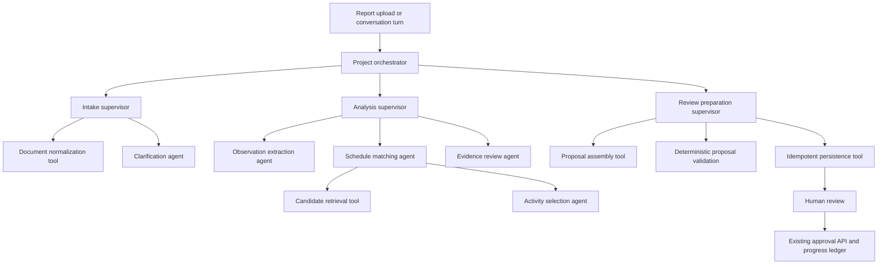

# Hierarchical multi-agent architecture and migration plan

Status: proposed for review; no runtime changes. Prepared 15 October 2026.

## Objective

Replace the flat report-analysis workflow and separate conversation analysis with a bounded hierarchy: one project orchestrator, domain supervisors, and specialist agents. Preserve evidence-backed schedule matching, durable jobs, provider configuration, and human approval before progress changes.

The hierarchy is logical. Agents initially run inside the existing Python worker, using the existing model adapter and database. Separate services, queues per agent, and different models are optional later decisions.

## Current implementation

- `backend/app/agent/graph.py` assembles a fixed LangGraph pipeline: context → extraction → validation/repair → retrieval → selection → validation/repair → persistence → finalization.
- `backend/app/agent/nodes.py` implements those stages through `AgentTools`; extraction and selection invoke model-backed services.
- `backend/app/agent/runtime.py` owns job leases, PostgreSQL checkpoints, durable resume, proposal persistence, and terminal publication.
- `backend/app/conversation/service.py` separately extracts observations, matches schedule activities, asks clarification questions, and prepares draft events.
- `backend/app/agent/state.py`, `policy.py`, public schemas, and telemetry assume fixed stage names and budgets. State currently allows 16 node executions, two extraction calls, and two total corrective retries.
- Existing local changes include model-provider and conversation work. Implementation must incorporate those changes without overwriting them.

There are already several model-backed stages, but no explicit supervisor hierarchy or scoped agent delegation contract. Renaming the existing stages would not deliver the requested architecture.

## Proposed hierarchy

### Level 1: project orchestrator

Owns the request lifecycle, project and schedule identity, global budget, cancellation, and final outcome. Dispatches only registered supervisors. Routes from typed outcomes such as `completed`, `needs_clarification`, `retryable_failure`, `failed`, and `stale`.

Use deterministic orchestration initially. An additional model call to choose between known workflow stages adds latency without a demonstrated benefit. Supervisors likewise use explicit policy; specialist agents supply model reasoning where needed.

### Level 2: domain supervisors

| Supervisor | Responsibility | Completion contract |
| --- | --- | --- |
| Intake | Load project scope, normalize source references, establish trusted dates, handle conversation clarification | Valid source context or a persisted clarification request |
| Analysis | Delegate extraction, schedule matching, and evidence review; reconcile their results and bounded repairs | Validated observation and selection bundles, or an explicit unresolved outcome |
| Review preparation | Assemble proposed effects, validate business rules, save pending review items once | Ready-for-review result with persisted proposal references |

### Level 3 and 4: specialists

| Specialist | Allowed context and tools | Output |
| --- | --- | --- |
| Clarification agent | Current conversation and unresolved structured fields | One focused question, unresolved field identifiers, and answer-validation rules |
| Observation extraction agent | Scoped report fragments, trusted report metadata, extraction adapter | Typed observations with quoted evidence and uncertainty |
| Schedule matching agent | Validated observations and pinned schedule version; retrieval tool and selection child | One resolved or unresolved match result per observation |
| Activity selection agent | One observation, evidence, and bounded candidate set | Typed candidate choice or explicit abstention with reasons |
| Evidence review agent | Proposed observations/matches and their cited source fragments | Supported findings and structured objections; no persistence rights |

The matching agent is the additional hierarchy level: it owns candidate retrieval and delegates selection. Evidence review starts with deterministic evidence, date, and scope checks. A bounded model critique may be added for ambiguous semantic cases only after evaluation shows a benefit. This avoids an unconditional extra model call for every report.

Agents have separate input/output schemas, scoped tool interfaces, role-specific prompts, budgets, and trace identities. They may share a model. Tools such as retrieval, arithmetic, persistence, and ledger updates remain ordinary deterministic code.

## Execution and handoff contracts

1. The worker obtains its existing job lease. The orchestrator pins the project, source, and schedule version.
2. Intake returns normalized source references. Conversation requests can persist `awaiting_input`; a waiting conversation does not retain a running job lease. Reports with missing information can produce unresolved proposals under the existing review contract.
3. Analysis extracts observations. Validation rejects unsupported fragment references and untrusted date resolution before matching begins.
4. Schedule matching retrieves candidates and delegates one bounded selection task per observation. Initial execution stays sequential because current tools and counters use shared mutable state.
5. Evidence review checks the result. A typed objection routes only the responsible specialist through its remaining repair allowance. Disagreement is retained as unresolved when the allowance is exhausted; a supervisor cannot invent evidence.
6. Review preparation computes effects through existing domain functions, validates the pinned schedule version, and persists pending proposals idempotently.
7. The orchestrator terminates ready for human review, unresolved, failed, or stale. Only the existing approval transaction may apply ledger effects.

Each task envelope contains `task_id`, `parent_task_id`, `run_id`, `agent_role`, project/source/schedule IDs, input references, contract version, deadline, and budget allocation. Each result contains task identity, outcome, typed output references, evidence references, warnings, typed errors, actual usage, and schema version.

Parents validate child identity, scope, schema, and outcome before accepting results. The orchestrator owns the canonical run state; children return scoped updates rather than arbitrary writes to global state. Provider clients, database sessions, credentials, and lease tokens stay in ephemeral runtime dependencies, outside checkpoints.

## State, durability, and observability

Retain one root job and run per report. Child tasks are not independent top-level jobs in the first migration. Introduce durable `agent_tasks` records linked to `agent_runs`, with parent task references, role, attempt, status, input fingerprint, output references, timestamps, and sanitized error fields. Record specialist steps and tool calls against their task identity.

Use versioned supervisor subgraphs and explicit child input/output adapters. Checkpoints contain serializable task state and references; application records expose sanitized status. Prototype nested checkpoint and streaming behavior against the installed package versions before selecting the final wiring.

Assign a stable task identity from run, role, observation key, and attempt. Persistence reuses existing output-conflict checks and transaction boundaries. A crash after a model response but before its durable checkpoint may repeat the model call; domain writes must remain idempotent. Persisted successful child results should be reused when their input fingerprint matches.

Extend public status with agent role and parent/child relationships while retaining the existing stage summary. Raw prompts, source bodies, credentials, and internal model reasoning are not public trace fields.

## Budgets and failures

- Start with the existing extraction and selection repair allowances; supervisor nesting does not reset them.
- Replace the flat 16-node assumption with separately validated supervisor-transition, specialist-call, and tool-call limits. Derive explicit numeric limits from the finalized graph and worst-case observation fan-out before enabling it.
- Add run-wide wall-clock and model-call budgets. Child allocations consume the same root budget, including failures and repairs.
- Retry transient provider failures within a bounded allowance. Schema/evidence repair and transport retry consume distinct counters but both count toward the root call/deadline limits.
- Schedule changes invalidate the run and child outputs. Lease loss and cancellation stop further tool execution.
- No-match and missing-information outcomes are expected review results rather than infrastructure failures.
- Start with concurrency one. Introduce bounded fan-out only after database sessions, telemetry, model metadata, and budget reservation are safe under concurrency.

## Migration sequence

| Phase | Changes | Exit criteria |
| --- | --- | --- |
| 1. Freeze baseline | Capture current report and conversation fixtures, outputs, model-call counts, latency, and failure/resume behavior | Baseline evaluation is reproducible; local provider changes preserved |
| 2. Contracts and roles | Add task/result schemas, role registry, scoped tool interfaces, supervisor routing policy, and global budget accounting | Reject unknown roles, invalid parentage, scope changes, and exhausted budgets |
| 3. Specialist boundaries | Wrap current extraction and selection services; implement schedule matching supervisor and evidence-review checks | Existing approved fixtures retain expected results; unsupported evidence remains rejected |
| 4. Hierarchical report runtime | Add supervisor subgraphs, task persistence migration, trace support, and runtime integration behind a feature flag | End-to-end report run, restart, cancellation, lease loss, and stale schedule checks pass |
| 5. Conversation integration | Route conversation extraction/matching through shared specialist contracts; persist clarification state and resume on a user turn | Clarification preserves user turns and produces the same review handoff as reports |
| 6. Shadow evaluation | Compare old and new execution using a non-writing persistence adapter for the shadow path | No duplicate proposals or ledger writes; quality and latency meet agreed thresholds |
| 7. Controlled rollout | Enable new runs selectively, retain legacy runtime for existing checkpoints, then expand | Rollback tested and monitoring covers failure rate, budget use, and pending tasks |

Suggested new modules: `agent/orchestrator.py`, `agent/contracts.py`, `agent/registry.py`, `agent/budgets.py`, `agent/supervisors/`, and `agent/specialists/`. Adapt existing `graph.py`, `nodes.py`, `tools.py`, `runtime.py`, `state.py`, `policy.py`, `telemetry.py`, public schemas, and conversation service. Extend database models and migrations for child tasks; update status endpoints and the existing frontend trace display after backend contracts stabilize.

## Checkpoint compatibility and rollback

Introduce a new graph and state schema version for the hierarchical runtime. Existing runtime currently compares stored versions against a single current version; this must become explicit version dispatch. Route already-started v1 runs to retained v1 code and new flagged runs to v2. Never interpret a v1 checkpoint as a v2 subgraph checkpoint.

Use additive schema changes. Turning off the new-run flag sends subsequent jobs to v1; in-progress v2 runs finish on v2 or are explicitly cancelled and restarted under a documented operator procedure. A restart must reuse domain idempotency protections. Do not delete existing checkpoints during rollout.

## Required verification

- Contract and policy tests: scoped tool access, typed child outputs, identity mismatches, bounded delegation depth, and root budget conservation.
- Report integration: valid matches, no candidates, contradictory evidence, untrusted dates, malformed model responses, repair exhaustion, and mixed successful/unresolved observations.
- Conversation integration: missing date/location/scope, repeated replies, preserved source turns, and handoff to human review.
- PostgreSQL durability: restart within each supervisor and child, checkpoint/write boundary failures, stale schedules, expired leases, and exactly one set of persisted proposals after retry.
- Version coexistence: old runs resume through v1; new runs use v2; flag rollback does not strand either version.
- Authorization: specialists cannot write approvals or ledger effects, and evidence review cannot persist proposals.
- Evaluation: compare mapping correctness, unsupported claims, abstention quality, model calls, elapsed time, and failure rate with the captured baseline. Set rollout thresholds from baseline measurements before enabling v2 broadly.

## Recommended first implementation slice

Implement the report path through root orchestrator → analysis supervisor → extraction and schedule matching specialists, with typed handoffs, scoped tools, durable child tasks, and existing deterministic review validation. Keep execution sequential and retain the existing provider settings. Integrate conversation intake next. Add semantic critique or parallel fan-out only when measured quality or latency justifies it.

This first slice creates real delegation and ownership boundaries while keeping the current domain behavior reviewable. It does not require a new agent framework or a new model provider.
